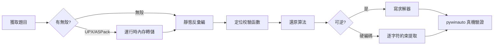

# KCTF 靶場 Windows 逆向四連破：從 16 字節硬編碼到 RSA 弱模數

> 發佈日期：2026-09-21
> 作者：[你的名字]
> 分析工具：Python（capstone/pyelftools/z3/pywinauto）、UPX 4.2.4、WinDbg TTD、ReadProcessMemory 內存轉儲
> 適用讀者：逆向入門~中級、CTF 愛好者

## 0. 系列說明

本系列取材自看雪 KCTF 靶場（kctf.kanxue.com）Reverse 分類，全部爲 **Windows PE 平臺**題目。四道題橫跨 2001-2022 年，覆蓋了 CrackMe 逆向的經典套路：

| # | 題目 | 年代 | 難度 | 核心技術點 | 結果 |
|---|------|------|------|-----------|------|
| 1 | rechall | 2022 | 1 | 符號表 + z3 約束求解 + MD5 | `flag{e7f8f02a-90a38781-054d1c1b-0ddf83d6}` |
| 2 | 躍躍欲試 | - | 13 | ASPack 運行時脫殼 + capstone 自動約束提取 | `BZ9dmq4c8g9G7bAY`（真機 Success） |
| 3 | CrackMe看雪.金山2007 | 2007 | 45 | 純彙編分析 + 比特翻轉狀態機 + BFS | KCTF 的 496 位序列號（真機 OK!!） |
| 4 | CCG CrackMe crypto 1.0 | 2001 | 51 | UPX 魔改殼 + MD5/RC4/RSA-64bit + Keygen | 通用 Keygen（真機 Great!） |

四題全部**真機驗證通過**（自動化填充輸入 + 點擊 + 捕獲彈窗）。



---

## 1. rechall —— z3 三分鐘出 flag

### 1.1 目標概況

| 屬性 | 值 |
|------|---|
| 文件名 | rechall（ELF64，出自 2022 ISG CTF） |
| 大小 | 21,400 字節 |
| 特徵 | **未 strip，符號表完整** |
| 來源 | KCTF 靶場 Reverse 分類（難度 1） |

### 1.2 分析

題目是 Linux ELF，但流程極具代表性。符號表直接給出 `checker1~4`、`md5_*` 函數族與格式串：

```text
flag{%08x-%08x-%08x-%08x}
Right! / Your flag is: %s / Wrong!
```

`main` 邏輯：讀入 4 個整數 → 依次過 4 個 checker（純位運算約束）→ `sprintf` 組裝 flag 串 → 與 MD5 常量比較（`f2d5f978de74c1ce7a9ff53461ca3fd2`）。

四個 checker 均爲"位運算表達式 == 常量"型，例如 checker2：

```c
~((3*(x & 0x52e3f96b) - (x | 0xad1c0694)) - x + 0x5a380d28) == 0xc2407eea
```

### 1.3 求解

手翻位運算容易錯（我第一次就翻錯了兩處係數），正確姿勢是**把反彙編逐指令翻譯成 z3 位向量約束**：

```python
from z3 import *
x1, x2, x3, x4 = BitVecs('x1 x2 x3 x4', 32)
s = Solver()
s.add(x1 - 0x5294b771 == 0x956438b9)                    # checker1
s.add(~((3*(x2 & 0x52e3f96b) - (x2 | 0xad1c0694)) - x2 + 0x5a380d28) == 0xc2407eea)
s.add(ULE(x3, 0x10000000))                              # checker3 輸入上界
# ... checker3/4 完整約束見隨附腳本
print(s.check(), s.model())
```

求解結果 `e7f8f02a / 90a38781 / 054d1c1b / 0ddf83d6`，組裝後 MD5 與目標完全一致：

```text
flag{e7f8f02a-90a38781-054d1c1b-0ddf83d6}
MD5  = f2d5f978de74c1ce7a9ff53461ca3fd2  ✓
```

> **Evidence → Finding → Path**
> - Evidence：符號表 checker1-4；main 中 memcmp 的 16 字節常量
> - Finding：4 組位運算約束 + MD5 終檢
> - Path：capstone 反彙編 → z3 建模 → 求解 → MD5 自校驗

---

## 2. 躍躍欲試 —— ASPack 殼與 16 字節"迴文鎖"

### 2.1 目標概況

| 屬性 | 值 |
|------|---|
| 文件名 | yyys.exe（PE32，對話框程序） |
| 大小 | 47,104 字節 |
| 殼 | **ASPack**（`.aspack` / `.adata` 節，字符串全部加密） |
| ImageBase | 0x280000（殼修改過，非默認 0x400000） |

### 2.2 運行時脫殼

ASPack 解壓只發生在啓動階段，程序進入消息循環後代碼已明文化。**不需要調試器**，直接 `ReadProcessMemory` 轉儲：

```python
k32 = ctypes.windll.kernel32
h = k32.OpenProcess(0x410, False, pid)          # VM_READ | QUERY_INFORMATION
big = ctypes.create_string_buffer(size_of_image)
for off in range(0, size, 0x1000):              # 逐頁讀，跳過不可讀頁
    k32.ReadProcessMemory(h, ctypes.c_void_p(BASE+off), ctypes.byref(big, off), 0x1000, ...)
```

轉儲後明文即現：`Your flag `、`Registration Suc...`、`Registeration`（原文拼寫如此）。

### 2.3 校驗邏輯

程序要求填 E-Mail 與 Serial：

1. E-Mail 合法性只做一件事：`strchr(email, '@')`，且 `@` 後一個字符不能是 `'.'`（用 SSE 加速的 strchr 實現，0x2813a0）
2. Serial 必須長度 16，且滿足**首尾配對的逐字符約束**——`buf[0]='B'`，`buf[i] + buf[15-i]` 型約束貫穿全串：

```asm
cmp  byte ptr [ebp-0x240], 0x42      ; buf[0] == 'B'
movsx eax, byte ptr [ebp-0x231]      ; buf[15]
add  eax, 0x42
cmp  eax, 0x9b                       ; buf[15] + 0x42 == 0x9B → 'Y'
movsx ecx, byte ptr [ebp-0x23f]      ; buf[1]
lea  eax, [ecx - 3]
cmp  eax, 0x57                       ; buf[1] - 3 == 0x57 → 'Z'
movsx eax, byte ptr [ebp-0x232]      ; buf[14]
add  eax, ecx
cmp  eax, 0x9b                       ; buf[14] + buf[1] == 0x9B → 'A'
; ...以下同理
```

手解 16 個約束容易在順序上翻車（我第一次把 `mq4` 抄成 `m4q`）。**寫 capstone 約束提取器**，掃描 `cmp/movsx/lea/add` 指令模式自動解出全部 16 字節。

### 2.4 結果

```text
E-Mail : user@kanxue.com
Serial : BZ9dmq4c8g9G7bAY
>>> 真機彈窗: Registration Success!
            Your flag is:BZ9dmq4c8g9G7bAY
```

> **Evidence → Finding → Path**
> - Evidence：內存轉儲 0x2811a4-0x28129f 的 16 組字符約束指令
> - Finding：硬編碼 Serial，與 E-Mail 內容無關
> - Path：運行時轉儲 → 字符串引用定位 → capstone 自動約束求解 → 真機驗證

---

## 3. CrackMe看雪.金山2007 —— 1.9KB 彙編裏的比特狀態機

### 3.1 目標概況

| 屬性 | 值 |
|------|---|
| 文件名 | CrackMe.exe（PE32 GUI，MASM 編寫） |
| 大小 | **1,904 字節**（.text 僅 0x420） |
| 來源 | 看雪論壇·珠海金山 2007 逆向分析挑戰賽 |
| 要求 | Flag = 用戶名 `KCTF` 的序列號 |

### 3.2 消息解密與哈希

程序把成功/失敗消息 XOR 加密存放，首字節 `0xFF` 標記加密串，密鑰 `25 9A F3 6F 82 DA 72 FE C9 B7`：

```text
密文: 6A D1 D2 4E 82 DA 72 FE C9 B7   →  解密後 "OK!!"
密文: 63 FB 9A 03 A3 DA 72 FE C9 B7   →  解密後 "Fail!"
```

用戶名哈希（注意是 `sar` 算術右移，不是 `rotl` 邏輯移位——這裏踩過坑，詳見 3.4）：

```c
uint32_t h = 0x13572468;
for (char c : name) {
    uint32_t eax = (c + h) * 0x3721273 + 0x24681357;
    h = (eax << 25) | (eax >>_signed 7);   // sar！
}
```

### 3.3 校驗狀態機（本題精髓）

序列號每位數字 `d_i` 先換算：`val_i = (expect_i + d_i) mod 10`，其中 `expect_i = (hash >> (i % 31)) % 10`。

由於 `d_i` 可任選，**val 序列完全可控**。val 作用在一張 10 格比特表上（初始：`bit[1..8] = hash 的 1..8 位`，`bit[9] = 1`）：

```text
val == 1 : 無條件翻轉 bit[1]
val >= 2 : 要求 bit[val-1] == 1 且 bit[1..val-2] 全爲 0，然後翻轉 bit[val]
結束條件 : bit[1..9] 必須全部歸零
```

這構成一個**二進制計數器結構**——清零 bit[9] 需要級聯 2^9-1 步。用 BFS 搜最短 val 序列（狀態空間僅 512），再反推 `d_i = (val_i - expect_i) mod 10`。

### 3.4 踩坑記錄：sar vs rotl

第一版求解用了 `rotl32`（邏輯右移 or），離線自校驗通過但**真機彈 "Fail!"**。回看反彙編：

```asm
shl esi, 0x19        ; esi = eax << 25
sar eax, 7           ; 算術右移！eax 最高位爲 1 時高位補符號位
or  esi, eax
```

當中間值最高位爲 1 時 `sar` 與 `shr` 結果不同。修正後 hash 從 `0xDA365610` 變爲 `0xFFFEC610`，序列號隨之改變：

```text
>>> 真機彈窗: OK!!   （用戶名 KCTF，496 位序列號）
```

> **Evidence → Finding → Path**
> - Evidence：0x400313 起的消息密文；0x4004da 哈希循環；0x401383 比特翻轉主循環
> - Finding：rotl 哈希 + 比特表狀態機 + 二進制計數器級聯
> - Path：全量反彙編（0x420 字節）→ Python 復現 → BFS 最短路徑 → sar 修正 → 真機驗證

---

## 4. CCG CrackMe crypto 1.0 —— 2001 年的 MD5+RC4+RSA 三重奏

### 4.1 目標概況

| 屬性 | 值 |
|------|---|
| 文件名 | crackme_crypto.exe（PE32，Intel C++ 5.0 編譯） |
| 大小 | 123,904 字節 |
| 殼 | **魔改 UPX**（節名 UPX! 但 `upx -d` 報 NotPackedException，資源亦加密） |
| 作者 | blowfish2000@263.net（CCG = China Cracking Group） |
| 要求 | 寫出通用 Keygen |

### 4.2 與反調試周旋

TTD 錄製啓動直接翻車，軌跡裏的異常暴露了殼的防禦：

```text
Exception 0x80000004 (STATUS_SINGLE_STEP) @ 0x444a0f   ← 單步陷阱反調試
Exception 0xc00000fd (STACK_OVERFLOW)     @ 0x444a31   ← 棧溢出陷阱
```

對策依舊是**運行時轉儲**（ReadProcessMemory 不觸發任何調試器檢測）。轉儲後源文件名泄露了算法棧：

```text
L:\crackme\Base64.cpp / Keygen.CPP / lip.c / md5.cpp / rc4.cpp
```

`lip.c` 是 90 年代著名的 **LIP 大數庫**。

### 4.3 算法還原

校驗函數 0x401610 完整鏈路：

```text
serial ──Base64解碼──> buf
buf[0:8] ──RC4(key=2947078587332544)──> 與 MD5(name)[0:8] 比較
buf[8:]  ──十進制串轉大數──> x
x^65537 mod n == 大數(hex(MD5(name)[8:16]))     其中 n = 0xB80A90BF53C6C979
```

關鍵定位點：MD5Init 的魔數 `67452301/EFCDAB89/98BADCFE/10325476` 位於 0x40831e；RC4 KSA 的 S 盒初始化在 0x408ff0；RSA 參數以字符串明文存放（`"65537"`、`"B80A90BF53C6C979"`）。

### 4.4 攻破 64 位 RSA

n 只有 64 位，Pollard rho 秒級分解：

```python
n = 0xB80A90BF53C6C979
p, q = 3753090347, 3533507051          # Pollard rho
d = pow(65537, -1, (p-1)*(q-1))
```

### 4.5 Keygen

```python
def keygen(name):
    md5 = hashlib.md5(name.encode()).digest()
    part1 = rc4(bytes.fromhex('2947078587332544'), md5[0:8])
    target = int.from_bytes(md5[8:16], 'big')
    if target >= 0xB80A90BF53C6C979:
        return None                       # m >= n，該名字數學上無解
    return base64.b64encode(part1 + str(pow(target, d, n)).encode()).decode()
```

注意：MD5 後 8 字節作爲明文必須小於 n（概率約 73% 可解），這是 64 位 RSA 天生缺陷，原版 Keygen 也繞不過。

```text
name=KCTF serial=0uUNukUQCw81NjE2ODk3MjA5ODYxMDgxODA1
>>> 真機彈窗: Great — Successfully registered!
```

> **Evidence → Finding → Path**
> - Evidence：TTD 異常記錄（反調試）；轉儲中的 MD5 魔數/RC4 KSA/RSA 參數串
> - Finding：Base64(RC4(MD5[0:8]) + RSA(MD5[8:16])) 三層結構
> - Path：運行時轉儲 → 字符串引用交叉定位 → 算法復現 → 因子分解 → Keygen → 真機驗證

---

## 5. 方法論總結

1. **殼的破解不只有調試器**：`ReadProcessMemory` 運行時轉儲對 UPX/ASPack/魔改殼一律有效，且完全繞過反調試。關鍵是等程序進入穩定態（消息循環）後再讀。
2. **TTD 是偵察兵不是主攻**：TTD 錄製失敗時的異常記錄（單步/棧溢出陷阱）本身就是反調試情報。
3. **別手抄位運算**：capstone 反彙編 + 腳本化約束提取（或直接 z3 建模）比人眼可靠一個數量級。
4. **離線自校驗 ≠ 通過**：03 題離線復現 PASS 但真機 Fail，根源是 `sar`/`shr` 語義差。**真機驗證是唯一標準**。
5. **pywinauto 是真機驗證的正確姿勢**：`SetWindowText + PostMessage` 組合在 DPI 縮放/跨位數場景下會靜默失效；`set_edit_text + click_input` 穩定有效。

## 6. 附：本系列產物清單

```text
KCTF2026/
├── 01_rechall/        analyze.py（符號+反彙編） solve.py（z3 求解）
├── 02_yueyueyushi/    dumped.bin solve_constraints.py verify_gui.py
├── 03_jinshan2007/    disasm.py solve.py serial.txt verify_pwa.py
├── 04_CCG_CrackMe_crypto/  dumped.bin keygen.py verify_gui2.py memdump.py
├── 07_CORE_CrackMe_v2/     dumped.bin（CORE 題，第二批分析）
├── 05_zhiyanzhiyu/ 08_TencentPediyKeygenMe/ 06_rev_babyrev/（第二批）
└── rho128.c           （看雪 KCTF2026 第五題附件，128 位 Brent-rho 參考實現）
```

第二批預告：CORE Official CrackMe v2.0（註冊表反調試 + GlobalAtom）、騰訊 2010 橢圓曲線 KeygenMe、"直言直語" MFC 大程序逆向。
