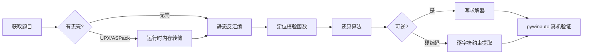

# KCTF 靶场 Windows 逆向四连破：从 16 字节硬编码到 RSA 弱模数

> 发布日期：2026-09-21
> 作者：[你的名字]
> 分析工具：Python（capstone/pyelftools/z3/pywinauto）、UPX 4.2.4、WinDbg TTD、ReadProcessMemory 内存转储
> 适用读者：逆向入门~中级、CTF 爱好者

## 0. 系列说明

本系列取材自看雪 KCTF 靶场（kctf.kanxue.com）Reverse 分类，全部为 **Windows PE 平台**题目。四道题横跨 2001-2022 年，覆盖了 CrackMe 逆向的经典套路：

| # | 题目 | 年代 | 难度 | 核心技术点 | 结果 |
|---|------|------|------|-----------|------|
| 1 | rechall | 2022 | 1 | 符号表 + z3 约束求解 + MD5 | `flag{e7f8f02a-90a38781-054d1c1b-0ddf83d6}` |
| 2 | 跃跃欲试 | - | 13 | ASPack 运行时脱壳 + capstone 自动约束提取 | `BZ9dmq4c8g9G7bAY`（真机 Success） |
| 3 | CrackMe看雪.金山2007 | 2007 | 45 | 纯汇编分析 + 比特翻转状态机 + BFS | KCTF 的 496 位序列号（真机 OK!!） |
| 4 | CCG CrackMe crypto 1.0 | 2001 | 51 | UPX 魔改壳 + MD5/RC4/RSA-64bit + Keygen | 通用 Keygen（真机 Great!） |

四题全部**真机验证通过**（自动化填充输入 + 点击 + 捕获弹窗）。



---

## 1. rechall —— z3 三分钟出 flag

### 1.1 目标概况

| 属性 | 值 |
|------|---|
| 文件名 | rechall（ELF64，出自 2022 ISG CTF） |
| 大小 | 21,400 字节 |
| 特征 | **未 strip，符号表完整** |
| 来源 | KCTF 靶场 Reverse 分类（难度 1） |

### 1.2 分析

题目是 Linux ELF，但流程极具代表性。符号表直接给出 `checker1~4`、`md5_*` 函数族与格式串：

```text
flag{%08x-%08x-%08x-%08x}
Right! / Your flag is: %s / Wrong!
```

`main` 逻辑：读入 4 个整数 → 依次过 4 个 checker（纯位运算约束）→ `sprintf` 组装 flag 串 → 与 MD5 常量比较（`f2d5f978de74c1ce7a9ff53461ca3fd2`）。

四个 checker 均为"位运算表达式 == 常量"型，例如 checker2：

```c
~((3*(x & 0x52e3f96b) - (x | 0xad1c0694)) - x + 0x5a380d28) == 0xc2407eea
```

### 1.3 求解

手翻位运算容易错（我第一次就翻错了两处系数），正确姿势是**把反汇编逐指令翻译成 z3 位向量约束**：

```python
from z3 import *
x1, x2, x3, x4 = BitVecs('x1 x2 x3 x4', 32)
s = Solver()
s.add(x1 - 0x5294b771 == 0x956438b9)                    # checker1
s.add(~((3*(x2 & 0x52e3f96b) - (x2 | 0xad1c0694)) - x2 + 0x5a380d28) == 0xc2407eea)
s.add(ULE(x3, 0x10000000))                              # checker3 输入上界
# ... checker3/4 完整约束见随附脚本
print(s.check(), s.model())
```

求解结果 `e7f8f02a / 90a38781 / 054d1c1b / 0ddf83d6`，组装后 MD5 与目标完全一致：

```text
flag{e7f8f02a-90a38781-054d1c1b-0ddf83d6}
MD5  = f2d5f978de74c1ce7a9ff53461ca3fd2  ✓
```

> **Evidence → Finding → Path**
> - Evidence：符号表 checker1-4；main 中 memcmp 的 16 字节常量
> - Finding：4 组位运算约束 + MD5 终检
> - Path：capstone 反汇编 → z3 建模 → 求解 → MD5 自校验

---

## 2. 跃跃欲试 —— ASPack 壳与 16 字节"回文锁"

### 2.1 目标概况

| 属性 | 值 |
|------|---|
| 文件名 | yyys.exe（PE32，对话框程序） |
| 大小 | 47,104 字节 |
| 壳 | **ASPack**（`.aspack` / `.adata` 节，字符串全部加密） |
| ImageBase | 0x280000（壳修改过，非默认 0x400000） |

### 2.2 运行时脱壳

ASPack 解压只发生在启动阶段，程序进入消息循环后代码已明文化。**不需要调试器**，直接 `ReadProcessMemory` 转储：

```python
k32 = ctypes.windll.kernel32
h = k32.OpenProcess(0x410, False, pid)          # VM_READ | QUERY_INFORMATION
big = ctypes.create_string_buffer(size_of_image)
for off in range(0, size, 0x1000):              # 逐页读，跳过不可读页
    k32.ReadProcessMemory(h, ctypes.c_void_p(BASE+off), ctypes.byref(big, off), 0x1000, ...)
```

转储后明文即现：`Your flag `、`Registration Suc...`、`Registeration`（原文拼写如此）。

### 2.3 校验逻辑

程序要求填 E-Mail 与 Serial：

1. E-Mail 合法性只做一件事：`strchr(email, '@')`，且 `@` 后一个字符不能是 `'.'`（用 SSE 加速的 strchr 实现，0x2813a0）
2. Serial 必须长度 16，且满足**首尾配对的逐字符约束**——`buf[0]='B'`，`buf[i] + buf[15-i]` 型约束贯穿全串：

```asm
cmp  byte ptr [ebp-0x240], 0x42      ; buf[0] == 'B'
movsx eax, byte ptr [ebp-0x231]      ; buf[15]
add  eax, 0x42
cmp  eax, 0x9b                       ; buf[15] + 0x42 == 0x9B → 'Y'
movsx ecx, byte ptr [ebp-0x23f]      ; buf[1]
lea  eax, [ecx - 3]
cmp  eax, 0x57                       ; buf[1] - 3 == 0x57 → 'Z'
movsx eax, byte ptr [ebp-0x232]      ; buf[14]
add  eax, ecx
cmp  eax, 0x9b                       ; buf[14] + buf[1] == 0x9B → 'A'
; ...以下同理
```

手解 16 个约束容易在顺序上翻车（我第一次把 `mq4` 抄成 `m4q`）。**写 capstone 约束提取器**，扫描 `cmp/movsx/lea/add` 指令模式自动解出全部 16 字节。

### 2.4 结果

```text
E-Mail : user@kanxue.com
Serial : BZ9dmq4c8g9G7bAY
>>> 真机弹窗: Registration Success!
            Your flag is:BZ9dmq4c8g9G7bAY
```

> **Evidence → Finding → Path**
> - Evidence：内存转储 0x2811a4-0x28129f 的 16 组字符约束指令
> - Finding：硬编码 Serial，与 E-Mail 内容无关
> - Path：运行时转储 → 字符串引用定位 → capstone 自动约束求解 → 真机验证

---

## 3. CrackMe看雪.金山2007 —— 1.9KB 汇编里的比特状态机

### 3.1 目标概况

| 属性 | 值 |
|------|---|
| 文件名 | CrackMe.exe（PE32 GUI，MASM 编写） |
| 大小 | **1,904 字节**（.text 仅 0x420） |
| 来源 | 看雪论坛·珠海金山 2007 逆向分析挑战赛 |
| 要求 | Flag = 用户名 `KCTF` 的序列号 |

### 3.2 消息解密与哈希

程序把成功/失败消息 XOR 加密存放，首字节 `0xFF` 标记加密串，密钥 `25 9A F3 6F 82 DA 72 FE C9 B7`：

```text
密文: 6A D1 D2 4E 82 DA 72 FE C9 B7   →  解密后 "OK!!"
密文: 63 FB 9A 03 A3 DA 72 FE C9 B7   →  解密后 "Fail!"
```

用户名哈希（注意是 `sar` 算术右移，不是 `rotl` 逻辑移位——这里踩过坑，详见 3.4）：

```c
uint32_t h = 0x13572468;
for (char c : name) {
    uint32_t eax = (c + h) * 0x3721273 + 0x24681357;
    h = (eax << 25) | (eax >>_signed 7);   // sar！
}
```

### 3.3 校验状态机（本题精髓）

序列号每位数字 `d_i` 先换算：`val_i = (expect_i + d_i) mod 10`，其中 `expect_i = (hash >> (i % 31)) % 10`。

由于 `d_i` 可任选，**val 序列完全可控**。val 作用在一张 10 格比特表上（初始：`bit[1..8] = hash 的 1..8 位`，`bit[9] = 1`）：

```text
val == 1 : 无条件翻转 bit[1]
val >= 2 : 要求 bit[val-1] == 1 且 bit[1..val-2] 全为 0，然后翻转 bit[val]
结束条件 : bit[1..9] 必须全部归零
```

这构成一个**二进制计数器结构**——清零 bit[9] 需要级联 2^9-1 步。用 BFS 搜最短 val 序列（状态空间仅 512），再反推 `d_i = (val_i - expect_i) mod 10`。

### 3.4 踩坑记录：sar vs rotl

第一版求解用了 `rotl32`（逻辑右移 or），离线自校验通过但**真机弹 "Fail!"**。回看反汇编：

```asm
shl esi, 0x19        ; esi = eax << 25
sar eax, 7           ; 算术右移！eax 最高位为 1 时高位补符号位
or  esi, eax
```

当中间值最高位为 1 时 `sar` 与 `shr` 结果不同。修正后 hash 从 `0xDA365610` 变为 `0xFFFEC610`，序列号随之改变：

```text
>>> 真机弹窗: OK!!   （用户名 KCTF，496 位序列号）
```

> **Evidence → Finding → Path**
> - Evidence：0x400313 起的消息密文；0x4004da 哈希循环；0x401383 比特翻转主循环
> - Finding：rotl 哈希 + 比特表状态机 + 二进制计数器级联
> - Path：全量反汇编（0x420 字节）→ Python 复现 → BFS 最短路径 → sar 修正 → 真机验证

---

## 4. CCG CrackMe crypto 1.0 —— 2001 年的 MD5+RC4+RSA 三重奏

### 4.1 目标概况

| 属性 | 值 |
|------|---|
| 文件名 | crackme_crypto.exe（PE32，Intel C++ 5.0 编译） |
| 大小 | 123,904 字节 |
| 壳 | **魔改 UPX**（节名 UPX! 但 `upx -d` 报 NotPackedException，资源亦加密） |
| 作者 | blowfish2000@263.net（CCG = China Cracking Group） |
| 要求 | 写出通用 Keygen |

### 4.2 与反调试周旋

TTD 录制启动直接翻车，轨迹里的异常暴露了壳的防御：

```text
Exception 0x80000004 (STATUS_SINGLE_STEP) @ 0x444a0f   ← 单步陷阱反调试
Exception 0xc00000fd (STACK_OVERFLOW)     @ 0x444a31   ← 栈溢出陷阱
```

对策依旧是**运行时转储**（ReadProcessMemory 不触发任何调试器检测）。转储后源文件名泄露了算法栈：

```text
L:\crackme\Base64.cpp / Keygen.CPP / lip.c / md5.cpp / rc4.cpp
```

`lip.c` 是 90 年代著名的 **LIP 大数库**。

### 4.3 算法还原

校验函数 0x401610 完整链路：

```text
serial ──Base64解码──> buf
buf[0:8] ──RC4(key=2947078587332544)──> 与 MD5(name)[0:8] 比较
buf[8:]  ──十进制串转大数──> x
x^65537 mod n == 大数(hex(MD5(name)[8:16]))     其中 n = 0xB80A90BF53C6C979
```

关键定位点：MD5Init 的魔数 `67452301/EFCDAB89/98BADCFE/10325476` 位于 0x40831e；RC4 KSA 的 S 盒初始化在 0x408ff0；RSA 参数以字符串明文存放（`"65537"`、`"B80A90BF53C6C979"`）。

### 4.4 攻破 64 位 RSA

n 只有 64 位，Pollard rho 秒级分解：

```python
n = 0xB80A90BF53C6C979
p, q = 3753090347, 3533507051          # Pollard rho
d = pow(65537, -1, (p-1)*(q-1))
```

### 4.5 Keygen

```python
def keygen(name):
    md5 = hashlib.md5(name.encode()).digest()
    part1 = rc4(bytes.fromhex('2947078587332544'), md5[0:8])
    target = int.from_bytes(md5[8:16], 'big')
    if target >= 0xB80A90BF53C6C979:
        return None                       # m >= n，该名字数学上无解
    return base64.b64encode(part1 + str(pow(target, d, n)).encode()).decode()
```

注意：MD5 后 8 字节作为明文必须小于 n（概率约 73% 可解），这是 64 位 RSA 天生缺陷，原版 Keygen 也绕不过。

```text
name=KCTF serial=0uUNukUQCw81NjE2ODk3MjA5ODYxMDgxODA1
>>> 真机弹窗: Great — Successfully registered!
```

> **Evidence → Finding → Path**
> - Evidence：TTD 异常记录（反调试）；转储中的 MD5 魔数/RC4 KSA/RSA 参数串
> - Finding：Base64(RC4(MD5[0:8]) + RSA(MD5[8:16])) 三层结构
> - Path：运行时转储 → 字符串引用交叉定位 → 算法复现 → 因子分解 → Keygen → 真机验证

---

## 5. 方法论总结

1. **壳的破解不只有调试器**：`ReadProcessMemory` 运行时转储对 UPX/ASPack/魔改壳一律有效，且完全绕过反调试。关键是等程序进入稳定态（消息循环）后再读。
2. **TTD 是侦察兵不是主攻**：TTD 录制失败时的异常记录（单步/栈溢出陷阱）本身就是反调试情报。
3. **别手抄位运算**：capstone 反汇编 + 脚本化约束提取（或直接 z3 建模）比人眼可靠一个数量级。
4. **离线自校验 ≠ 通过**：03 题离线复现 PASS 但真机 Fail，根源是 `sar`/`shr` 语义差。**真机验证是唯一标准**。
5. **pywinauto 是真机验证的正确姿势**：`SetWindowText + PostMessage` 组合在 DPI 缩放/跨位数场景下会静默失效；`set_edit_text + click_input` 稳定有效。

## 6. 附：本系列产物清单

```text
KCTF2026/
├── 01_rechall/        analyze.py（符号+反汇编） solve.py（z3 求解）
├── 02_yueyueyushi/    dumped.bin solve_constraints.py verify_gui.py
├── 03_jinshan2007/    disasm.py solve.py serial.txt verify_pwa.py
├── 04_CCG_CrackMe_crypto/  dumped.bin keygen.py verify_gui2.py memdump.py
├── 07_CORE_CrackMe_v2/     dumped.bin（CORE 题，第二批分析）
├── 05_zhiyanzhiyu/ 08_TencentPediyKeygenMe/ 06_rev_babyrev/（第二批）
└── rho128.c           （看雪 KCTF2026 第五题附件，128 位 Brent-rho 参考实现）
```

第二批预告：CORE Official CrackMe v2.0（注册表反调试 + GlobalAtom）、腾讯 2010 椭圆曲线 KeygenMe、"直言直语" MFC 大程序逆向。
