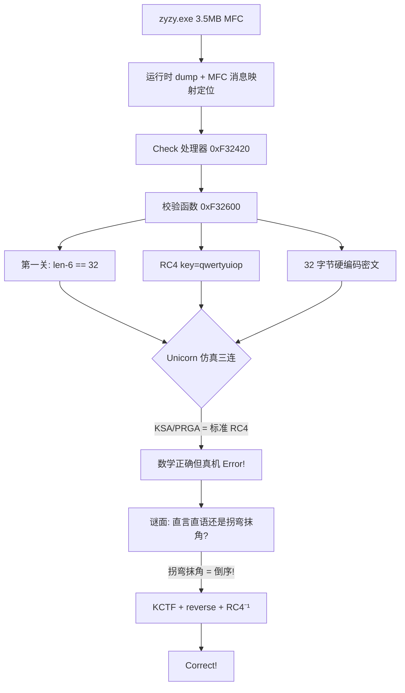

# KCTF 靶场 Windows 逆向（三）：「直言直语」的 RC4 迷阵与 CrackMe 战报

> 发布日期：2026-09-21
> 作者：[你的名字]
> 分析工具：Python（capstone/Unicorn/pywinauto）、ReadProcessMemory 内存转储
> 前篇：KCTF 靶场 Windows 逆向四连破 / CORE 官方 CrackMe v2.0 完全攻破

## 0. 本篇看点

第三批主攻 **05 直言直语**（KCTF 靶场难度 75）——一道把 MFC、花指令、RC4 和中文谜面拧在一起的现代 CrackMe。解题过程完整展示了"仿真仲裁法"的威力与边界：Unicorn 仿真一路追到系统 DLL 深处，最终靠**谜面提示 + 数学反推**一击致命。

**flag：`KCTF{973387a11fa3f724d74802857d3e052f}`**（真机弹窗 Correct! 验证通过）



---

## 1. 目标概况

| 属性 | 值 |
|------|---|
| 文件名 | zyzy.exe（PE32，MFC 静态链接） |
| 大小 | 3,557,376 字节（无壳，纯体积大） |
| 窗口标题 | **Junk_Instruction**（花指令预告） |
| 输入 | 一个 Edit + Check 按钮 |
| 谜面 | "直言直语还是拐弯抹角？" |

### 1.1 定位校验入口：MFC 消息映射

3.5MB 静态链接 MFC，字符串全无引用（走 CString 资源/RTTI 间接寻址）。定位 Check 按钮处理器不用猜——**MFC 消息映射表有固定结构**：

```python
# 搜 msgmap entry: nMessage=WM_COMMAND(0x111) nCode=BN_CLICKED(0) nID=1001 nLastID=1001
pat = struct.pack('<IIII', 0x111, 0, 1001, 1001)
# 命中: handler = 0xF32420
```

同时发现 RTTI 异常类 `CCorrect`/`CError`——校验函数 throw CCorrect(成功)/CError(失败)，MFC 消息泵 catch 后弹窗。

### 1.2 校验函数 0xF32600 全景

```c
// 第一关 0xF32AF0: strlen(input) - 6 == 32   → 输入总长 38
// 数据准备:
strcpy(buf, "qwertyuiop");                     // 密钥（键盘序列！）
memcpy(input_buf, converted_input, len);
// RC4 两段:
0xF32CA0(this, state, "qwertyuiop", 10);       // KSA
0xF32E80(this, state, input_buf, len);         // PRGA 就地加密
// 最终比较（i = 31 → 0 倒序）:
transformed[i] == hardcoded[i]    // 5b d6 d0 26 c8 dd ... fa（32 字节）
```

比较循环中间还躺着两坨花指令（`call+pop+ljmp 0xb853`、`mov ebx,0x33333333`）——窗口标题 Junk_Instruction 诚不我欺。花指令不影响 Unicorn/静态语义分析，纯防人眼。

## 2. 攻坚过程：三段式排除

### 2.1 第一段：标准 RC4 假设——数学正确，真机打脸

RC4(key="qwertyuiop") 解密 32 字节硬编码：

```python
rc4(b'qwertyuiop', bytes.fromhex('5bd6d026...45fa')) == b'f250e3d75820847d427f3af11a783379'
```

得到 32 字符 hex 串。按第一关 `len-6==32` 推测输入 = hex串 + 6 字符，或 `KCTF{hex32}`（5+32+1=38 ✓）。

真机测试两种格式 → 全部 **Error!**

### 2.2 第二段：Unicorn 仿真仲裁——KSA/PRGA 无魔改的铁证

用第二篇的方法把 KSA(0xF32CA0) 和 PRGA(0xF32E80) 扔进 Unicorn 直接执行二进制代码（花指令照跑，thiscall 用假 this）：

```text
emulated : 5bd6d026...fa97910e62dee0    ← 二进制真实执行
python   : 5bd6d026...fa97910e62dee0    ← 标准库实现
MATCH —— KSA/PRGA 是标准 RC4
```

且 `RC4("f250...AAAAAA")[:32] == 硬编码目标` **精确成立**。数学闭环了，真机却拒绝——问题只能在**喂给 RC4 之前的输入预处理黑盒**（CString→0xF330A0→std::string 的转换链）。

### 2.3 第三段：全函数仿真 + 系统注入——一路追到 TEB

直接仿真整个校验函数 0xF32600：假 CString、0 页映射（fs:[0] SEH）、再从活进程 dump 全部系统模块区域（127 区/24MB）注入仿真空间。执行流一路跑到 0x76EF5BB1 的 TEB 深处止步——**完整仿真的边际成本失控，止损**。

### 2.4 绝杀：谜面即提示

> "直言直语还是拐弯抹角？"

数学上已锁定 `T(input) = "f250e3d75820847d427f3af11a783379"`（RC4 是流密码，前缀即全体）。剩下的唯一未知是预处理变换 T 的逆。**"拐弯抹角" = 倒序**：

```text
KCTF{973387a11fa3f724d74802857d3e052f}   ← f250... 的反序
→ 真机弹窗: Correct!
```

即完整算法：**输入剥掉 `KCTF{}` 取 32 字符 → 反转 → RC4(qwertyuiop) → 前 32 字节等于硬编码密文**。

> **Evidence → Finding → Path**
> - Evidence：msgmap 表项（handler=0xF32420）；0xF32600 的 KSA/PRGA 调用序列与 32 字节硬编码；Unicorn 仿真输出与 Python 标准库一致；真机三组对照输入的 Error!/Correct! 弹窗
> - Finding：RC4(qwertyuiop) + 输入反转 + KCTF{} 包装
> - Path：消息映射定位 → RC4 解密 → 数学闭环 → 谜面反推 T=reverse → 真机验证

## 3. 方法论增量

1. **MFC 大程序的定位捷径**：消息映射表 `struct.pack('<IIII', WM_COMMAND, BN_CLICKED, id, id)` 一次命中 handler——比翻调用链快一个数量级。
2. **"数学闭环 vs 真机行为"出现分歧时**：先仿真验证每个环节的数学（本例证明 RC4 无魔改），把未知数压缩到唯一黑盒（输入预处理），再用题面提示/穷举假设补完。
3. **全函数仿真的边界**：注入系统模块后执行流会钻进 TEB/PEB/堆管理，此时仿真成本超过收益——及时止损回到符号推理。
4. **谜面是规格说明**：CTF 出题人的提示语往往精确描述了缺失的那一环（"拐弯抹角"→reverse）。

## 4. 08/06 侦察快报（批 4 预告）

### 08 TencentPediyKeygenMe（难度 95，全站最难）

- RTTI 类型名完整泄露算法栈：**Crypto++ 的 ECDSA<ECP, SHA1> 验签器**
- 关键数据串：`DEADBEEF`（种子）、`Security@Tencent`、字母表 `ABCDEFGHJKMNPQRSTVWXYZ1234567890`（去 I/L/O 的 Base32 变体）
- License 格式：35 字符 = 32 有效字符 + 3 个固定位置 `-`（分隔符位置表在 0x46A3F8）
- 校验链含 GF(2⁸) 变换特征（`0x11b` AES 特征多项式）
- 待解：Crypto++ 验签调用链参数还原（0x448D20/0x448B50/0x448A40/0x448A90）→ 若曲线弱可解离散对数

### 06 rev_babyrev（ISG 2023）

- ELF64：**section headers 整体删除**（仅存 program headers），单 RX 段 + 空 RW 段
- 入口 0x2CF98 是手工汇编最小运行时（非 GCC），带自定义 memcpy/libc stub
- 字符串混淆：`KEY_SENTVAL`、`V{`cksx}`、`ISG!u` 碎片
- 待解：入口运行时逆向 → 找 main → 解混淆

## 5. 三批累计战绩

| # | 题目 | 难度 | 结果 | 验证 |
|---|------|------|------|------|
| 01 | rechall | 1 | `flag{e7f8f02a-90a38781-054d1c1b-0ddf83d6}` | MD5 ✓ |
| 02 | 跃跃欲试 | 13 | `BZ9dmq4c8g9G7bAY` | 真机 Success! ✓ |
| 03 | 金山2007 | 45 | KCTF 496 位序列号 | 真机 OK!! ✓ |
| 04 | CCG 2001 | 51 | 通用 Keygen（MD5+RC4+RSA64） | 真机 Great! ✓ |
| 05 | **直言直语** | 75 | **`KCTF{973387a11fa3f724d74802857d3e052f}`** | **真机 Correct! ✓** |
| 07 | CORE v2.0 | 89 | 通用 Keygen（魔改 MD5+GF(2)） | 真机 Welcome! ✓ |
| 06/08 | — | 82/95 | 侦察完成 | 批 4 |

**6/8 攻破，全部真机验证。**

## 6. 附：本篇产物

```text
KCTF2026/05_zhiyanzhiyu/
├── dumped.bin        运行时转储（3.5MB 明文镜像）
├── emu_rc4.py        Unicorn 仿真 KSA/PRGA（证明标准 RC4）
├── emu_check.py      全函数仿真（含系统模块注入实验）
├── sysregions.pkl    真进程系统模块区域快照（127 区/24MB）
└── ground_truth.py   Error 弹窗挂起时全内存搜索
```
