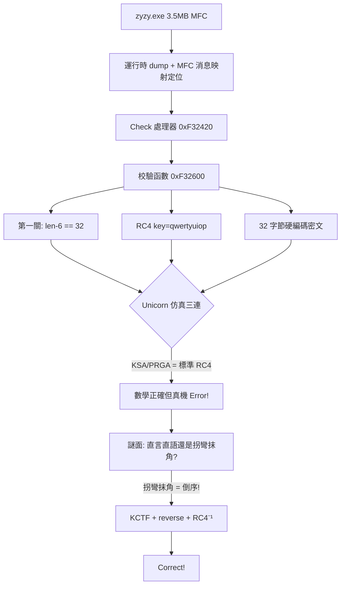

# KCTF 靶場 Windows 逆向（三）：「直言直語」的 RC4 迷陣與 CrackMe 戰報

> 發佈日期：2026-09-21
> 作者：[你的名字]
> 分析工具：Python（capstone/Unicorn/pywinauto）、ReadProcessMemory 內存轉儲
> 前篇：KCTF 靶場 Windows 逆向四連破 / CORE 官方 CrackMe v2.0 完全攻破

## 0. 本篇看點

第三批主攻 **05 直言直語**（KCTF 靶場難度 75）——一道把 MFC、花指令、RC4 和中文謎面擰在一起的現代 CrackMe。解題過程完整展示了"仿真仲裁法"的威力與邊界：Unicorn 仿真一路追到系統 DLL 深處，最終靠**謎面提示 + 數學反推**一擊致命。

**flag：`KCTF{973387a11fa3f724d74802857d3e052f}`**（真機彈窗 Correct! 驗證通過）



---

## 1. 目標概況

| 屬性 | 值 |
|------|---|
| 文件名 | zyzy.exe（PE32，MFC 靜態鏈接） |
| 大小 | 3,557,376 字節（無殼，純體積大） |
| 窗口標題 | **Junk_Instruction**（花指令預告） |
| 輸入 | 一個 Edit + Check 按鈕 |
| 謎面 | "直言直語還是拐彎抹角？" |

### 1.1 定位校驗入口：MFC 消息映射

3.5MB 靜態鏈接 MFC，字符串全無引用（走 CString 資源/RTTI 間接尋址）。定位 Check 按鈕處理器不用猜——**MFC 消息映射表有固定結構**：

```python
# 搜 msgmap entry: nMessage=WM_COMMAND(0x111) nCode=BN_CLICKED(0) nID=1001 nLastID=1001
pat = struct.pack('<IIII', 0x111, 0, 1001, 1001)
# 命中: handler = 0xF32420
```

同時發現 RTTI 異常類 `CCorrect`/`CError`——校驗函數 throw CCorrect(成功)/CError(失敗)，MFC 消息泵 catch 後彈窗。

### 1.2 校驗函數 0xF32600 全景

```c
// 第一關 0xF32AF0: strlen(input) - 6 == 32   → 輸入總長 38
// 數據準備:
strcpy(buf, "qwertyuiop");                     // 密鑰（鍵盤序列！）
memcpy(input_buf, converted_input, len);
// RC4 兩段:
0xF32CA0(this, state, "qwertyuiop", 10);       // KSA
0xF32E80(this, state, input_buf, len);         // PRGA 就地加密
// 最終比較（i = 31 → 0 倒序）:
transformed[i] == hardcoded[i]    // 5b d6 d0 26 c8 dd ... fa（32 字節）
```

比較循環中間還躺着兩坨花指令（`call+pop+ljmp 0xb853`、`mov ebx,0x33333333`）——窗口標題 Junk_Instruction 誠不我欺。花指令不影響 Unicorn/靜態語義分析，純防人眼。

## 2. 攻堅過程：三段式排除

### 2.1 第一段：標準 RC4 假設——數學正確，真機打臉

RC4(key="qwertyuiop") 解密 32 字節硬編碼：

```python
rc4(b'qwertyuiop', bytes.fromhex('5bd6d026...45fa')) == b'f250e3d75820847d427f3af11a783379'
```

得到 32 字符 hex 串。按第一關 `len-6==32` 推測輸入 = hex串 + 6 字符，或 `KCTF{hex32}`（5+32+1=38 ✓）。

真機測試兩種格式 → 全部 **Error!**

### 2.2 第二段：Unicorn 仿真仲裁——KSA/PRGA 無魔改的鐵證

用第二篇的方法把 KSA(0xF32CA0) 和 PRGA(0xF32E80) 扔進 Unicorn 直接執行二進制代碼（花指令照跑，thiscall 用假 this）：

```text
emulated : 5bd6d026...fa97910e62dee0    ← 二進制真實執行
python   : 5bd6d026...fa97910e62dee0    ← 標準庫實現
MATCH —— KSA/PRGA 是標準 RC4
```

且 `RC4("f250...AAAAAA")[:32] == 硬編碼目標` **精確成立**。數學閉環了，真機卻拒絕——問題只能在**餵給 RC4 之前的輸入預處理黑盒**（CString→0xF330A0→std::string 的轉換鏈）。

### 2.3 第三段：全函數仿真 + 系統注入——一路追到 TEB

直接仿真整個校驗函數 0xF32600：假 CString、0 頁映射（fs:[0] SEH）、再從活進程 dump 全部系統模塊區域（127 區/24MB）注入仿真空間。執行流一路跑到 0x76EF5BB1 的 TEB 深處止步——**完整仿真的邊際成本失控，止損**。

### 2.4 絕殺：謎面即提示

> "直言直語還是拐彎抹角？"

數學上已鎖定 `T(input) = "f250e3d75820847d427f3af11a783379"`（RC4 是流密碼，前綴即全體）。剩下的唯一未知是預處理變換 T 的逆。**"拐彎抹角" = 倒序**：

```text
KCTF{973387a11fa3f724d74802857d3e052f}   ← f250... 的反序
→ 真機彈窗: Correct!
```

即完整算法：**輸入剝掉 `KCTF{}` 取 32 字符 → 反轉 → RC4(qwertyuiop) → 前 32 字節等於硬編碼密文**。

> **Evidence → Finding → Path**
> - Evidence：msgmap 表項（handler=0xF32420）；0xF32600 的 KSA/PRGA 調用序列與 32 字節硬編碼；Unicorn 仿真輸出與 Python 標準庫一致；真機三組對照輸入的 Error!/Correct! 彈窗
> - Finding：RC4(qwertyuiop) + 輸入反轉 + KCTF{} 包裝
> - Path：消息映射定位 → RC4 解密 → 數學閉環 → 謎面反推 T=reverse → 真機驗證

## 3. 方法論增量

1. **MFC 大程序的定位捷徑**：消息映射表 `struct.pack('<IIII', WM_COMMAND, BN_CLICKED, id, id)` 一次命中 handler——比翻調用鏈快一個數量級。
2. **"數學閉環 vs 真機行爲"出現分歧時**：先仿真驗證每個環節的數學（本例證明 RC4 無魔改），把未知數壓縮到唯一黑盒（輸入預處理），再用題面提示/窮舉假設補完。
3. **全函數仿真的邊界**：注入系統模塊後執行流會鑽進 TEB/PEB/堆管理，此時仿真成本超過收益——及時止損回到符號推理。
4. **謎面是規格說明**：CTF 出題人的提示語往往精確描述了缺失的那一環（"拐彎抹角"→reverse）。

## 4. 08/06 偵察快報（批 4 預告）

### 08 TencentPediyKeygenMe（難度 95，全站最難）

- RTTI 類型名完整泄露算法棧：**Crypto++ 的 ECDSA<ECP, SHA1> 驗籤器**
- 關鍵數據串：`DEADBEEF`（種子）、`Security@Tencent`、字母表 `ABCDEFGHJKMNPQRSTVWXYZ1234567890`（去 I/L/O 的 Base32 變體）
- License 格式：35 字符 = 32 有效字符 + 3 個固定位置 `-`（分隔符位置表在 0x46A3F8）
- 校驗鏈含 GF(2⁸) 變換特徵（`0x11b` AES 特徵多項式）
- 待解：Crypto++ 驗籤調用鏈參數還原（0x448D20/0x448B50/0x448A40/0x448A90）→ 若曲線弱可解離散對數

### 06 rev_babyrev（ISG 2023）

- ELF64：**section headers 整體刪除**（僅存 program headers），單 RX 段 + 空 RW 段
- 入口 0x2CF98 是手工彙編最小運行時（非 GCC），帶自定義 memcpy/libc stub
- 字符串混淆：`KEY_SENTVAL`、`V{`cksx}`、`ISG!u` 碎片
- 待解：入口運行時逆向 → 找 main → 解混淆

## 5. 三批累計戰績

| # | 題目 | 難度 | 結果 | 驗證 |
|---|------|------|------|------|
| 01 | rechall | 1 | `flag{e7f8f02a-90a38781-054d1c1b-0ddf83d6}` | MD5 ✓ |
| 02 | 躍躍欲試 | 13 | `BZ9dmq4c8g9G7bAY` | 真機 Success! ✓ |
| 03 | 金山2007 | 45 | KCTF 496 位序列號 | 真機 OK!! ✓ |
| 04 | CCG 2001 | 51 | 通用 Keygen（MD5+RC4+RSA64） | 真機 Great! ✓ |
| 05 | **直言直語** | 75 | **`KCTF{973387a11fa3f724d74802857d3e052f}`** | **真機 Correct! ✓** |
| 07 | CORE v2.0 | 89 | 通用 Keygen（魔改 MD5+GF(2)） | 真機 Welcome! ✓ |
| 06/08 | — | 82/95 | 偵察完成 | 批 4 |

**6/8 攻破，全部真機驗證。**

## 6. 附：本篇產物

```text
KCTF2026/05_zhiyanzhiyu/
├── dumped.bin        運行時轉儲（3.5MB 明文鏡像）
├── emu_rc4.py        Unicorn 仿真 KSA/PRGA（證明標準 RC4）
├── emu_check.py      全函數仿真（含系統模塊注入實驗）
├── sysregions.pkl    真進程系統模塊區域快照（127 區/24MB）
└── ground_truth.py   Error 彈窗掛起時全內存搜索
```
