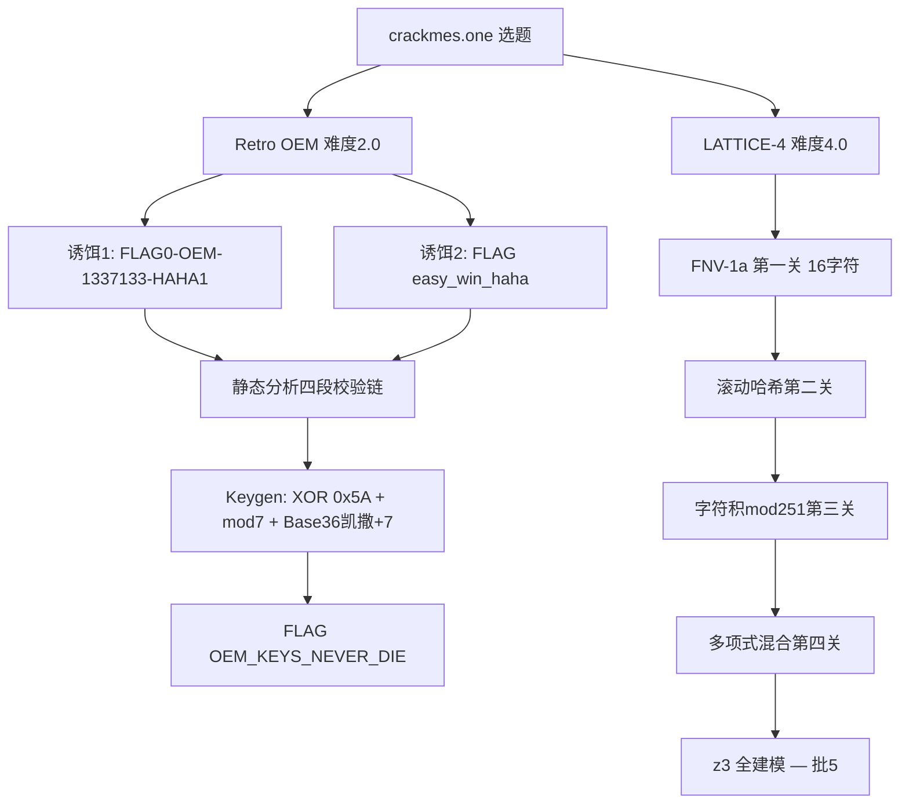

# crackmes.one 实战：Retro OEM 完全攻破与 LATTICE-4 四重哈希迷阵

> 发布日期：2026-09-21
> 作者：[你的名字]
> 分析工具：Python（capstone/pefile）、TDM-GCC、pywinauto/subprocess 自动验证
> 前篇：KCTF 靶场系列（一）（二）（三）

## 0. 本篇看点

走出 KCTF，进军**全球最大的 CrackMe 发布平台 crackmes.one**。本篇完整记录两道最新 Windows 逆向题的攻坚：

1. **Retro OEM License Check**（难度 2.0）——从 Win95 时代的 OEM 密钥格式复活战，含双重诱饵陷阱，**完整 Keygen 攻破**
2. **LATTICE-4**（难度 4.0）——同作者的进阶之作，**四重独立哈希联锁**，算法已全部还原（z3 求解为后续计划）



---

## 1. Retro OEM License Check —— 完全攻破

### 1.1 目标概况

| 属性 | 值 |
|------|---|
| 题目 | werrec's Retro OEM License Check（2026-09-20 上传） |
| 平台 | Windows x64，MinGW 编译，控制台程序（ANSI 彩色 UI） |
| 大小 | 24.5 KB |
| 密钥格式 | `XXXXX-OEM-XXXXXXX-XXXXX`（Win95 OEM 风格） |
| 规则 | No patching，要求 Keygen |

### 1.2 双重诱饵

程序里躺着两个"明文答案"，全是坑：

```text
诱饵1: FLAG0-OEM-1337133-HAHA1  → "Nice try. That string is bait. Keep reversing."
诱饵2: FLAG{easy_win_haha}      → "Invalid serial. Access denied."
```

第一个诱饵有专门的 strcmp 拦截并嘲讽；第二个放行到真校验被拒。作者对逆向者的心理战。

### 1.3 四段校验链还原（0x1400022f2）

```c
check1: len==23 && s[5]/s[9]/s[17]=='-' && s[6:9]=="OEM"
        && s[0:5]∪s[18:23] ∈ [0-9A-Z] && s[10:17] 纯数字
check2: s[0]^s[1]^s[2]^s[3]^s[4] == 0x5A          // 前段异或
check3: Σ(s[i]-'0') for i in 10..16 ≡ 0 (mod 7)    // 中段模7
check4: s[18+i] == base36(base36(s[i]) + 7 mod 36)  // 尾段=前段凯撒+7!
```

第四段是精髓：把前段每字符当 Base36 值（0-9→0-9，A-Z→10-35），**+7 后取模 36 再转回字符**——一个伪装成校验的凯撒密码。

### 1.4 Keygen

```python
def keygen():
    a = make_prefix()      # 4 随机字符 + 1 个补 XOR==0x5A 的字符
    mid = make_mid()       # 7 数字，和 mod 7 == 0
    tail = ''.join(ALNUM[(int(c, 36) + 7) % 36] for c in a)
    return f'{a}-OEM-{mid}-{tail}'
```

真机验证：

```text
KEY: NEXJC-OEM-0496540-UL4QJ
>>> Correct! FLAG{OEM_KEYS_NEVER_DIE}
```

> **Evidence → Finding → Path**
> - Evidence：0x1400022f2 的四段调用链反汇编；两处诱饵 strcmp
> - Finding：XOR/mod7/Base36 凯撒三重约束
> - Path：诱饵试错 → 静态还原四段规则 → Python keygen → 真机 FLAG

---

## 2. LATTICE-4 —— 四重哈希联锁（算法还原）

### 2.1 概况

| 属性 | 值 |
|------|---|
| 题目 | werrec's LATTICE-4（2026-09-20 上传） |
| 平台 | Windows x64 控制台，密码 16 字符 [A-Za-z0-9] |
| 大小 | 24.5 KB |

### 2.2 攻坚过程（两次翻车）

**第一次翻车：FNV-1a 读错比较目标**

```asm
movzx eax, byte ptr [rdx]
xor   eax, ecx              ; eax = c ^ h
imul  ecx, eax, 0x1000193   ; h 更新在 ecx！
...
cmp   eax, 0x53fdd974        ; 比较的是中间值 (h15^c16)，不是最终哈希！
```

`imul ecx, eax, imm` 的目标操作数是 **ecx**——最终 `cmp eax` 拿到的是**乘法前的中间值**。我按"最终哈希=目标"构造暴力解，输出 `[ NO ]`。修正后用**末字符唯一解法**（c16 = h15 ^ TARGET，随机前缀直到 c16 落在字符集，C 语言 5353 万轮 7 秒命中）通过第一关。

**第二次认知升级：FNV 只是入场券**

第一关通过后进入 0x140003d09，发现还有三重独立校验：

```c
// 第二关: 自定义滚动哈希（查表 r10 + imul 0xA7 + xor + rol 7 + imul 0x85ebca77）
hash2(input) == 0x73AC9527
// 第三关: 字符乘积模
(s[0]*s[1] + s[2]*s[3] + s[4]*s[5] + s[6]*s[7]) % 251 == 0xD1
// 第四关: 多项式混合
s[0]*31 + s[1]*17 + word[52]^... 组合 == 0x58DC8BD7
// 后面还有更多……
```

四重 32 位约束联合——随机暴力失效，正解是 **z3 全约束建模**（16 字符 BitVec 8×16，四关逐一翻译）。算法已完整还原，z3 建模列入批 5。

### 2.3 方法论沉淀

1. **`imul dst, src, imm` 读清目标操作数**——哈希链的"当前值"在哪，比较的就是哪，一字之差浪费一轮暴力。
2. **末字符唯一解法**：流式哈希的最后一步 `h16=(h15^c)*p` 中，固定 target 与 h15 后 c 唯一确定——把 62¹⁶ 搜索压缩为"随机前缀 + 命中概率 62/2³²"的一维采样，C 语言秒级。
3. **注意约束是"32 位值等于字符"而非"低 8 位"**——我在第一版 Python 里误当 62/256，10000 轮全 miss 才暴露。

---

## 3. 全球素材库建设（1+2+台湾）

本批同步建立的弹药库：

| 来源 | 状态 |
|------|------|
| **Flare-On**（Mandiant/Google 官方逆向赛） | 全部 12 届（2014-2025）题目直链 + zip 密码 `flare` 已归档；Flare-On 4 完整包已下载，12 届 955MB 包与第 5 届传输中 |
| **crackmes.one** | 下载管线打通（zip 密码 `crackmes.one`）；3 道题入库，1 道完全攻破 |
| **HITCON CTF**（台湾） | 官方 GitHub org `github.com/hitconctf`（各届官网 repo）+ 出题人个人存档（如 maple3142/My-CTF-Challenges 含 HITCON CTF 2022/2024）；配合 CTFtime 按年索引 |

## 4. 系列累计战绩

| 批次 | 成果 |
|------|------|
| KCTF 01-04 | 4 题全破（flag/序列号/Keygen×2） |
| KCTF 05/07 | 直言直语 + CORE v2.0 全破（真机验证） |
| crackmes.one | **Retro OEM 全破**（FLAG{OEM_KEYS_NEVER_DIE}）；LATTICE-4 算法还原 |
| 待办 | LATTICE-4 z3 求解、Flare-On 4 精选、HITCON 精选、KCTF 06/08 |

## 5. 附：本篇产物

```text
crackmes/
├── retro_oem/     keygen.py（完整 Keygen） + crackme_02.exe
└── lattice4/      brute2.c/brute4.c（末字符唯一解法） + 算法还原笔记
FlareOn/           Flare-On4.zip + 全部直链清单
docs/              本篇 md/docx/pdf
```
