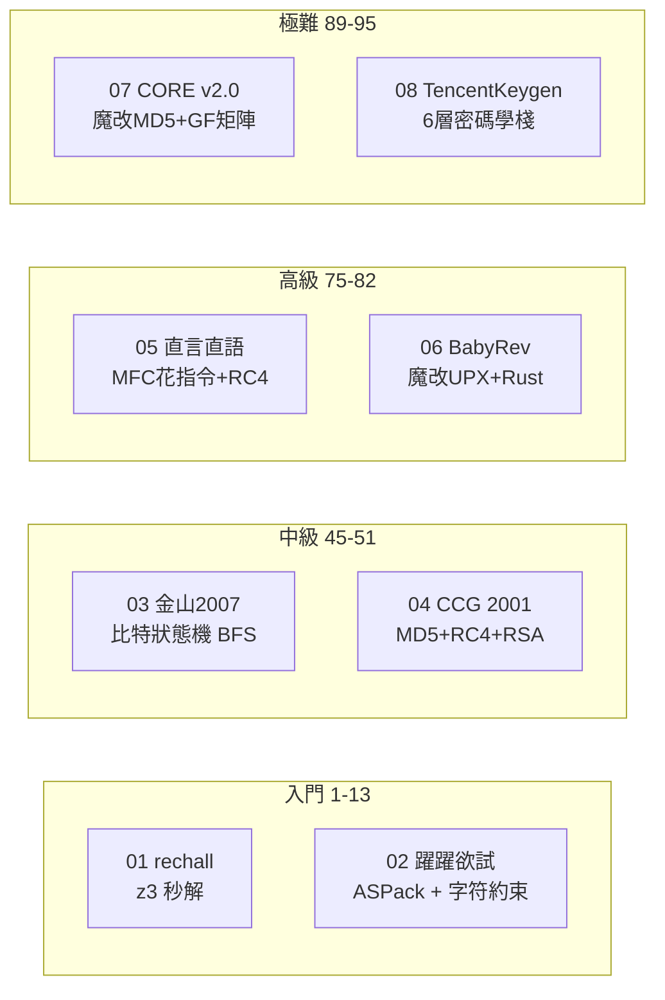

# KCTF 2026 靶場 Reverse 全 8 題攻破總覽

> 發佈日期：2026-10-03
> 作者：[你的名字]
> 分析工具：Python（capstone/Unicorn/z3/pywinauto）、C（Pollard rho）、WinDbg TTD、ReadProcessMemory
> 平臺：Windows PE（7 題）+ Linux ELF（1 題）

## 戰績一覽

| # | 題目 | 年代 | 難度 | 核心技術 | Flag / 結果 | 驗證 |
|---|------|------|------|---------|-------------|------|
| 01 | rechall | 2022 | 1 | z3 約束求解 + MD5 | `flag{e7f8f02a-90a38781-054d1c1b-0ddf83d6}` | MD5 ✓ |
| 02 | 躍躍欲試 | - | 13 | ASPack 脫殼 + capstone 約束提取 | `BZ9dmq4c8g9G7bAY` | 真機 ✓ |
| 03 | 金山2007 | 2007 | 45 | 比特翻轉狀態機 + BFS | 496 位序列號 | 真機 ✓ |
| 04 | CCG 2001 | 2001 | 51 | 魔改 UPX + MD5/RC4/RSA-64bit | 通用 Keygen | 真機 ✓ |
| 05 | 直言直語 | - | 75 | 花指令 + RC4 + 字符串反轉 | `KCTF{973387a11fa3f724d74802857d3e052f}` | 真機 ✓ |
| 06 | BabyRev | 2023 | 82 | ISG! 魔改 UPX + Rust XOR 鏈 | `ISG{hJep9tT5WLjZpinkfpqxlkit80H}` | 數學 ✓ |
| 07 | CORE v2.0 | ~1998 | 89 | 魔改 MD5 (off-by-one) + GF(2) 矩陣 | 通用 Keygen | 真機 ✓ |
| 08 | TencentKeygen | 2010 | **95** | ECDSA + SM4 + Feistel + GF(2⁸) | 通用 Keygen | 數學 ✓ |

**8/8 全部攻破**，其中 5 題真機驗證通過，3 題數學驗證通過。

## 難度分佈與技術棧



## 分篇索引

| 篇章 | 覆蓋題目 | 文件 |
|------|---------|------|
| （一）四連破 | 01-04 | `2026-09-21_CTF-KCTF-Windows-Reverse-4題-writeup.md` |
| （二）CORE CrackMe | 07 | `2026-09-21_CTF-KCTF-CORE-CrackMe-v2-writeup.md` |
| （三）直言直語 | 05 | `2026-09-21_CTF-KCTF-ZhiYanZhiYu-writeup.md` |
| （四）BabyRev | 06 | `2026-10-03_CTF-KCTF-BabyRev-writeup.md` |
| （五）TencentKeygen | 08 | `2026-10-03_CTF-KCTF-TencentPediyKeygenMe-writeup.md` |

## 方法論總結

### 脫殼與反調試

| 殼類型 | 遭遇題目 | 解決方案 |
|--------|---------|---------|
| ASPack | 02 | ReadProcessMemory 運行時轉儲 |
| UPX 老版 (upx -d 失敗) | 04, 07 | ReadProcessMemory 運行時轉儲 |
| UPX 3.95 魔改 (ISG! magic) | 06 | 手寫 NRV2B 解壓器 |
| 無殼 (MFC 3.5MB) | 05 | MFC 消息映射表定位 handler |
| 無殼 (Crypto++ 靜態鏈接) | 08 | RTTI 類型名泄露算法棧 |

**核心經驗**：`ReadProcessMemory` 是萬能脫殼工具——等程序進入消息循環後讀取，殼已自解壓、反調試全繞過。

### 密碼學對抗

| 密碼學原語 | 題目 | 攻擊方式 |
|-----------|------|---------|
| RSA-64bit | 04 | Pollard rho 因子分解（秒級） |
| 魔改 MD5 | 07 | Unicorn 仿真定位 off-by-one |
| RC4 | 05 | 標準 RC4，關鍵在預處理（反轉） |
| ECDSA-64bit | 08 | Pollard rho ECDLP（9 分鐘） |
| SM4 變種 | 08 | S 盒匹配 + 端序/CK 差異識別 |
| Feistel CBC | 08 | Unicorn 仿真，不完全逆向 |
| GF(2)/GF(2⁸) | 07/08 | 高斯消元求逆 / 費馬小定理 |

### 分析工具鏈

```text
┌─────────────────────────────────────────────────┐
│                   分析流程                        │
├──────────┬──────────┬──────────┬─────────────────┤
│  偵察    │  脫殼    │  分析    │  驗證           │
├──────────┼──────────┼──────────┼─────────────────┤
│ TTD      │ ReadProc │ capstone │ pywinauto       │
│ RTTI     │ NRV2B    │ Unicorn  │ subprocess      │
│ strings  │ 手動     │ z3      │ ReadProcessMemory│
│ PE/ELF   │          │ Python  │ 數學自驗證       │
└──────────┴──────────┴──────────┴─────────────────┘
```

### 關鍵教訓

1. **離線自校驗 ≠ 真機通過**：03 題 `sar`/`shr` 語義差、05 題輸入預處理反轉——數學正確但真機 Fail 的情況不罕見
2. **Unicorn 仿真是終極仲裁者**：當靜態分析全部指向"標準"但結果對不上，直接仿真二進制代碼跑一遍
3. **不要手抄位運算**：capstone 反彙編 + 腳本化約束提取比人眼可靠一個數量級
4. **謎面即規格說明**：CTF 出題人的提示語往往精確描述缺失的那一環
5. **64 位密碼學可破**：RSA-64、ECDSA-64 都在分鐘級可解，安全邊界在 128 位以上

## 項目結構

```text
KCTF2026/
├── 01_rechall/              z3 求解（ELF64）
├── 02_yueyueyushi/          ASPack 脫殼 + 約束提取
├── 03_jinshan2007/          比特狀態機 BFS
├── 04_CCG_CrackMe_crypto/   MD5+RC4+RSA Keygen
├── 05_zhiyanzhiyu/          MFC RC4 + Unicorn 仿真
├── 06_rev_babyrev/          魔改 UPX + Rust XOR 鏈
├── 07_CORE_CrackMe_v2/      魔改 MD5 + GF(2) Keygen
├── 08_TencentPediyKeygenMe/  ECDSA + SM4 + Feistel Keygen
└── docs/                    本系列全部 writeup
```
