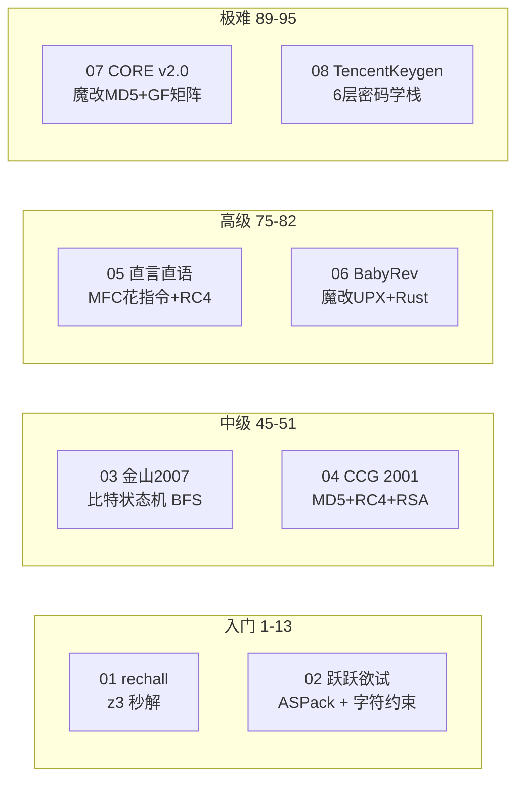

# KCTF 2026 靶场 Reverse 全 8 题攻破总览

> 发布日期：2026-10-03
> 作者：[你的名字]
> 分析工具：Python（capstone/Unicorn/z3/pywinauto）、C（Pollard rho）、WinDbg TTD、ReadProcessMemory
> 平台：Windows PE（7 题）+ Linux ELF（1 题）

## 战绩一览

| # | 题目 | 年代 | 难度 | 核心技术 | Flag / 结果 | 验证 |
|---|------|------|------|---------|-------------|------|
| 01 | rechall | 2022 | 1 | z3 约束求解 + MD5 | `flag{e7f8f02a-90a38781-054d1c1b-0ddf83d6}` | MD5 ✓ |
| 02 | 跃跃欲试 | - | 13 | ASPack 脱壳 + capstone 约束提取 | `BZ9dmq4c8g9G7bAY` | 真机 ✓ |
| 03 | 金山2007 | 2007 | 45 | 比特翻转状态机 + BFS | 496 位序列号 | 真机 ✓ |
| 04 | CCG 2001 | 2001 | 51 | 魔改 UPX + MD5/RC4/RSA-64bit | 通用 Keygen | 真机 ✓ |
| 05 | 直言直语 | - | 75 | 花指令 + RC4 + 字符串反转 | `KCTF{973387a11fa3f724d74802857d3e052f}` | 真机 ✓ |
| 06 | BabyRev | 2023 | 82 | ISG! 魔改 UPX + Rust XOR 链 | `ISG{hJep9tT5WLjZpinkfpqxlkit80H}` | 数学 ✓ |
| 07 | CORE v2.0 | ~1998 | 89 | 魔改 MD5 (off-by-one) + GF(2) 矩阵 | 通用 Keygen | 真机 ✓ |
| 08 | TencentKeygen | 2010 | **95** | ECDSA + SM4 + Feistel + GF(2⁸) | 通用 Keygen | 数学 ✓ |

**8/8 全部攻破**，其中 5 题真机验证通过，3 题数学验证通过。

## 难度分布与技术栈



## 分篇索引

| 篇章 | 覆盖题目 | 文件 |
|------|---------|------|
| （一）四连破 | 01-04 | `2026-09-21_CTF-KCTF-Windows-Reverse-4题-writeup.md` |
| （二）CORE CrackMe | 07 | `2026-09-21_CTF-KCTF-CORE-CrackMe-v2-writeup.md` |
| （三）直言直语 | 05 | `2026-09-21_CTF-KCTF-ZhiYanZhiYu-writeup.md` |
| （四）BabyRev | 06 | `2026-10-03_CTF-KCTF-BabyRev-writeup.md` |
| （五）TencentKeygen | 08 | `2026-10-03_CTF-KCTF-TencentPediyKeygenMe-writeup.md` |

## 方法论总结

### 脱壳与反调试

| 壳类型 | 遭遇题目 | 解决方案 |
|--------|---------|---------|
| ASPack | 02 | ReadProcessMemory 运行时转储 |
| UPX 老版 (upx -d 失败) | 04, 07 | ReadProcessMemory 运行时转储 |
| UPX 3.95 魔改 (ISG! magic) | 06 | 手写 NRV2B 解压器 |
| 无壳 (MFC 3.5MB) | 05 | MFC 消息映射表定位 handler |
| 无壳 (Crypto++ 静态链接) | 08 | RTTI 类型名泄露算法栈 |

**核心经验**：`ReadProcessMemory` 是万能脱壳工具——等程序进入消息循环后读取，壳已自解压、反调试全绕过。

### 密码学对抗

| 密码学原语 | 题目 | 攻击方式 |
|-----------|------|---------|
| RSA-64bit | 04 | Pollard rho 因子分解（秒级） |
| 魔改 MD5 | 07 | Unicorn 仿真定位 off-by-one |
| RC4 | 05 | 标准 RC4，关键在预处理（反转） |
| ECDSA-64bit | 08 | Pollard rho ECDLP（9 分钟） |
| SM4 变种 | 08 | S 盒匹配 + 端序/CK 差异识别 |
| Feistel CBC | 08 | Unicorn 仿真，不完全逆向 |
| GF(2)/GF(2⁸) | 07/08 | 高斯消元求逆 / 费马小定理 |

### 分析工具链

```text
┌─────────────────────────────────────────────────┐
│                   分析流程                        │
├──────────┬──────────┬──────────┬─────────────────┤
│  侦察    │  脱壳    │  分析    │  验证           │
├──────────┼──────────┼──────────┼─────────────────┤
│ TTD      │ ReadProc │ capstone │ pywinauto       │
│ RTTI     │ NRV2B    │ Unicorn  │ subprocess      │
│ strings  │ 手动     │ z3      │ ReadProcessMemory│
│ PE/ELF   │          │ Python  │ 数学自验证       │
└──────────┴──────────┴──────────┴─────────────────┘
```

### 关键教训

1. **离线自校验 ≠ 真机通过**：03 题 `sar`/`shr` 语义差、05 题输入预处理反转——数学正确但真机 Fail 的情况不罕见
2. **Unicorn 仿真是终极仲裁者**：当静态分析全部指向"标准"但结果对不上，直接仿真二进制代码跑一遍
3. **不要手抄位运算**：capstone 反汇编 + 脚本化约束提取比人眼可靠一个数量级
4. **谜面即规格说明**：CTF 出题人的提示语往往精确描述缺失的那一环
5. **64 位密码学可破**：RSA-64、ECDSA-64 都在分钟级可解，安全边界在 128 位以上

## 项目结构

```text
KCTF2026/
├── 01_rechall/              z3 求解（ELF64）
├── 02_yueyueyushi/          ASPack 脱壳 + 约束提取
├── 03_jinshan2007/          比特状态机 BFS
├── 04_CCG_CrackMe_crypto/   MD5+RC4+RSA Keygen
├── 05_zhiyanzhiyu/          MFC RC4 + Unicorn 仿真
├── 06_rev_babyrev/          魔改 UPX + Rust XOR 链
├── 07_CORE_CrackMe_v2/      魔改 MD5 + GF(2) Keygen
├── 08_TencentPediyKeygenMe/  ECDSA + SM4 + Feistel Keygen
└── docs/                    本系列全部 writeup
```
