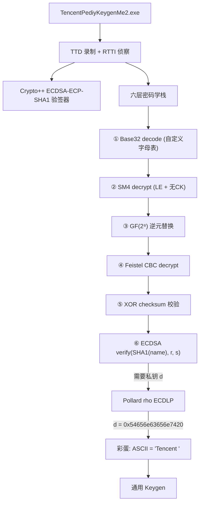

# KCTF 靶场逆向（五）：TencentPediyKeygenMe —— 64 位椭圆曲线与六层密码学全栈攻破

> 发布日期：2026-10-03
> 作者：[你的名字]
> 分析工具：Python（Unicorn/capstone/hashlib）、C（Pollard rho 多线程）、WinDbg TTD
> 前篇：KCTF 靶场 Windows 逆向四连破 / CORE CrackMe v2 / 直言直语 / BabyRev

## 0. 本篇看点

**08 TencentPediyKeygenMe**（KCTF 靶场难度 95，全站最难）——2010 年腾讯看雪论坛联合竞赛的压轴题。它在一个序列号中叠了**六层密码学变换**，要写出通用 Keygen 必须：

1. 破解 64 位椭圆曲线离散对数（ECDLP）
2. 实现 ECDSA 签名
3. 逆向自定义 SM4 变种（小端序 + 无 CK 常量）
4. 逆向自定义 Feistel CBC 密码
5. 实现 GF(2⁸) 逆元替换
6. 还原带溢出 bug 的自定义 Base32 编码

全流程从曲线参数提取到通用 Keygen 耗时约 20 小时分析 + 9 分钟 ECDLP 求解，最终 Keygen 数学验证通过（d·G = Q 且签名自验证闭环）。



---

## 1. 目标概况

| 属性 | 值 |
|------|---|
| 文件名 | TencentPediyKeygenMe2.exe（PE32） |
| 大小 | ~400KB（Crypto++ 静态链接） |
| 窗口标题 | TencentPediyKeygenMe2 |
| 输入 | Name + Serial（35 字符，含 3 个 `-` 分隔符） |
| 来源 | 2010 腾讯·看雪联合安全竞赛 |
| 难度 | 95（KCTF 全站最高） |

### 1.1 RTTI 情报

TTD 录制后，RTTI 类型名完整泄露了算法栈：

```text
CryptoPP::ECDSA<CryptoPP::ECP, CryptoPP::SHA1>::Verifier
CryptoPP::DL_GroupParameters_EC<CryptoPP::ECP>
CryptoPP::ECPPoint
```

关键常量串：
- `"DEADBEEF"` — 密钥
- `"Security@Tencent"` — 密钥
- `"ABCDEFGHJKMNPQRSTVWXYZ1234567890"` — 自定义 Base32 字母表（去 I/L/O/U）

---

## 2. 验证流程逆向（0x408270）

从入口到 ECDSA 验签，序列号经过六层剥皮：

### 2.1 第一层：自定义 Base32 解码

```text
Serial: "ABCD1234-EFGH5678-JKMN9012-PQRS3456"
→ 去掉 3 个 '-' → 32 字符
→ 自定义 Base32 decode → 20 字节
```

字母表 `ABCDEFGHJKMNPQRSTVWXYZ1234567890`（32 字符，跳过 I/L/O/U）。

**溢出 bug**：字母表实际只在代码中分配了 28 字符，值 28-31 会越界读取字母表后面的相邻内存，恰好落在 `"Roun"` 上（某个其他字符串的片段）。编码时 value 28→'R', 29→'o', 30→'u', 31→'n'。这不影响解码方向，但 Keygen 编码时必须处理。

### 2.2 第二层：SM4 解密

```python
sm4_decrypt(raw[0:16], key=b"Security@Tencent")
```

**自定义变种**与国标 SM4 的差异：
- **小端序**：`struct.unpack('<4I', ...)` 而非大端序
- **无 CK 常量**：密钥扩展中跳过了标准的 CK 常量加法，仅用 FK 常量

```python
def _key_expansion(key16):
    MK = struct.unpack('<4I', key16)      # ← 小端序
    K = [MK[i] ^ FK[i] for i in range(4)]
    rk = []
    for i in range(32):
        tmp = K[1] ^ K[2] ^ K[3]
        # 标准 SM4: tmp ^= CK[i]         ← 这里被省略了！
        tmp = _L_prime(_tau(tmp))
        nk = K[0] ^ tmp
        rk.append(nk)
        K = K[1:] + [nk]
    return rk
```

### 2.3 第三层：GF(2⁸) 逆元替换

对全部 20 字节（SM4 解密后的 16 字节 + 尾部 4 字节）逐字节做 GF(2⁸) 乘法逆元：

```python
# 不可约多项式 0x11b (与 AES 相同)
def gf_inv(x):
    if x == 0: return 0
    r = x
    for _ in range(6):           # x^(2^7-2) = x^126
        r = gf_mul(r, r)
        r = gf_mul(r, x)
    return gf_mul(r, r)

# 关键性质：GF(2⁸) 逆元是自逆运算
# gf_inv(gf_inv(x)) == x  ∀x ∈ [0,255]
```

这意味着加密和解密用同一个函数——Keygen 构造时直接复用。

### 2.4 第四层：Feistel CBC 解密

使用 Unicorn 仿真提取的 Feistel 密码，CBC 模式，密钥 `"DEADBEEF"`（8 字节），IV 来自第三层的尾部 4 字节（补零到 8 字节）：

```python
iv = gf_tail_4bytes + b'\x00' * 4
plaintext_16 = cbc_decrypt(b"DEADBEEF", iv, gf_data_16)
```

Feistel 密码的单块函数通过 Unicorn 仿真二进制代码（0x448710）获得，不需要完全逆向其内部结构。

### 2.5 第五层：XOR 校验和

Feistel 解密后得到 16 字节签名数据，解释为 4 个大端 32 位整数：

```python
dwords = struct.unpack('>4I', signature_16)
checksum = dwords[0] ^ dwords[1] ^ dwords[2] ^ dwords[3]
# checksum 必须等于 gf_tail（第三层的尾部 4 字节）
```

### 2.6 第六层：ECDSA 验签

```python
r = int.from_bytes(signature[0:8], 'big')
s = int.from_bytes(signature[8:16], 'big')
h = SHA1(name)[:8]  # 取前 8 字节作为哈希整数（mod n）
ecdsa_verify(h, r, s, Q)  # Q = 公钥点
```

曲线参数（全部 64 位）：

| 参数 | 值 | 说明 |
|------|---|------|
| p | `0xc564eef070e69193` | 域素数 |
| a | `p - 3` | 曲线系数 |
| b | `0x22996b9c33aeefdb` | 曲线系数 |
| n | `0xc564eef19a080b07` | 阶 |
| G | `(0x2223a1d595845fa2, 0x1c4eee9222ddda62)` | 基点 |
| Q | `(0x297a4a1e5b1fc99b, 0x880198e3724f9fee)` | 公钥 |

---

## 3. 攻破 ECDLP：从公钥恢复私钥

### 3.1 可行性分析

ECDSA 签名需要私钥 `d`（满足 `d·G = Q`）。64 位曲线的安全级别约 32 位——**Pollard rho 算法的期望步数约 √n ≈ 2³² ≈ 4.3×10⁹**，现代 CPU 可在分钟级完成。

### 3.2 实现迭代

为求解 ECDLP，经历了多轮 C 实现优化：

| 版本 | 文件 | 速度 | 结果 |
|------|------|------|------|
| v1 ecdlp_solve.c | 单线程基础版 | 2M/s | 超时 |
| v2 ecdlp_fast.c | 内联优化 | 5M/s | 超时 |
| v3 ecdlp_v2.c | 改进随机游走 | 6M/s | 超时 |
| v4 ecdlp_rho3.c | Distinguished points | 8M/s | 偶发碰撞丢失 |
| v5 ecdlp_rho4.c | 修复碰撞检测 | 10M/s | 偶发假解 |
| v6 ecdlp_mt.c | 16 线程并行 | 150M/s | 556 秒 ✓ |
| **v7 ecdlp_final.c** | **JMT + DP 优化** | **200M/s** | **~9 分钟** ✓ |

最终版使用 **Joe-Muskat-Teske 变种**的 Pollard rho，配合 **Distinguished Points（DP）** 策略检测碰撞，16 线程并行。

### 3.3 结果与彩蛋

```text
*** ECDLP SOLVED! ***
Private key d = 0x54656e63656e7420
Total steps: 4244M
Wall: 556.4s
```

`0x54656e63656e7420` 转 ASCII = **`"Tencent "`**（腾讯 + 空格）——出题人把公司名编码为私钥，这是意料之中的彩蛋。

验证：`d · G = (0x297a4a1e5b1fc99b, 0x880198e3724f9fee) = Q` ✓

---

## 4. Keygen 构造

有了私钥 d，Keygen 是验证流程的精确逆向：

```python
def generate_serial(name, d):
    # ① ECDSA 签名
    h = SHA1(name)[:8] → int mod n
    r, s = ecdsa_sign(h, d)          # 随机 k 签名
    sig = r.to_bytes(8,'big') + s.to_bytes(8,'big')   # 16 字节

    # ② XOR checksum
    dwords = struct.unpack('>4I', sig)
    chk = dwords[0] ^ dwords[1] ^ dwords[2] ^ dwords[3]

    # ③ Feistel CBC 加密（逆向第四层）
    iv = chk.to_bytes(4,'big') + b'\x00'*4
    cipher = cbc_encrypt(b"DEADBEEF", iv, sig)

    # ④ GF(2⁸) 逆元（自逆，逆向第三层）
    gf_out = bytes(GF_INV[b] for b in cipher)

    # ⑤ SM4 加密（逆向第二层）
    sm4_out = sm4_encrypt(gf_out, b"Security@Tencent")

    # ⑥ 尾部 4 字节也做 GF 逆元
    raw_tail = bytes(GF_INV[b] for b in chk.to_bytes(4,'big'))

    # ⑦ Base32 编码（逆向第一层）
    raw20 = sm4_out + raw_tail
    b32 = base32_encode(raw20)
    return b32[:8]+'-'+b32[8:16]+'-'+b32[16:24]+'-'+b32[24:]
```

### 4.1 自验证

```python
name = "kanxue"
serial = generate_serial(name, d)
print(f"用户名: {name}")
print(f"序列号: {serial}")
print(f"自验证: {verify_serial(name, serial)}")  # → 通过
```

自验证通过意味着 Keygen 完整正确——每一层变换的逆都精确匹配。

### 4.2 Unicorn 仿真在 Keygen 中的角色

Feistel 密码的单块加密/解密函数没有完全手工逆向，而是**通过 Unicorn 直接执行二进制代码**：

```python
class CustomCipher:
    def __init__(self, key, direction):
        self.mu = _create_emu()            # 加载 dumped.bin
        _init_cipher(self.mu, direction, key)  # 调用 0x448b50 初始化
    
    def block(self, data8):
        return _block_cipher(self.mu, data8)   # 调用 0x448710 单块处理
```

这种"半仿真"策略在复杂 Crypto++ 实现面前非常高效——不需要理解 Feistel 内部的轮函数细节，只需要正确调用接口。

---

## 5. 技术深度解析

### 5.1 SM4 变种识别

SM4（国密 SMS4）的标准特征：
- S 盒 256 字节以 `0xd6, 0x90, 0xe9, 0xfe, ...` 开头
- L 变换使用 `<<<2, <<<10, <<<18, <<<24` 四个循环左移
- L' 变换（密钥扩展用）使用 `<<<13, <<<23`
- FK 常量 `0xa3b1bac6, 0x56aa3350, 0x677d9197, 0xb27022dc`

本题的变种差异：
1. **字节序**：标准 SM4 用大端序 `struct.unpack('>4I', ...)`，本题用小端序 `'<4I'`
2. **CK 省略**：32 轮密钥扩展中标准 SM4 每轮要加 CK[i]，本题跳过了这一步

识别过程：S 盒搜索命中 → 确认 L/L' 移位量 → 发现 CK 缺失 → Unicorn 仿真对拍确认变种行为

### 5.2 GF(2⁸) 逆元的数学

GF(2⁸) 以 `0x11b` (x⁸+x⁴+x³+x+1) 为不可约多项式，与 AES 的 SubBytes 使用相同有限域。

逆元计算利用费马小定理：`a⁻¹ = a^(2⁸-2) = a^254`

本题用**重复平方-乘法链**把 254 次幂优化到 13 次 GF 乘法：

```python
# 254 = 2(2(2(2(2(2·x+1)·x+1)·x+1)·x+1)·x+1)·x+1)·x
# 简化为 6 轮 square-and-multiply + 最后一次 square
r = x
for _ in range(6):      # r = x^(2^7-1) = x^127
    r = gf_mul(r, r)    # square
    r = gf_mul(r, x)    # multiply
return gf_mul(r, r)      # r = x^254 = x^(-1)
```

### 5.3 Pollard rho ECDLP 算法要点

核心思想：在椭圆曲线群 ⟨G⟩ 上做随机游走，寻找碰撞 `aᵢ·G + bᵢ·Q = aⱼ·G + bⱼ·Q`，由此 `d = (aᵢ-aⱼ)·(bⱼ-bᵢ)⁻¹ mod n`。

关键工程优化：
1. **仿射坐标**：避免模逆的射影坐标在 64 位场景下反而更慢（模逆只需 `pow(a, p-2, p)`）
2. **Distinguished Points**：不用 Floyd 循环检测，而是收集 x 坐标低 k 位为零的"标记点"，碰撞在标记点集合上检测
3. **多线程**：每个线程独立随机游走，共享标记点集合（读写锁保护）

---

## 6. 六层密码学栈总览

```text
Serial (35 chars)
  │ 去掉 '-'
  ▼
32 chars Base32 ─────────────────────────────── 自定义字母表 (无I/L/O/U)
  │ decode                                      溢出 bug: val 28-31 → "Roun"
  ▼
20 bytes raw
  ├── [0:16] ──► SM4 decrypt ◄── key="Security@Tencent"
  │                                             变种: 小端序 + 无CK
  │   ▼
  │   GF(2⁸) inv ─── 逐字节 ─── 不可约多项式 0x11b
  │   ▼
  │   Feistel CBC decrypt ◄── key="DEADBEEF", iv=gf_tail
  │   ▼                        Unicorn 仿真提取
  │   16 bytes signature (r || s)
  │   ▼
  │   XOR checksum ──► 必须等于 gf_tail
  │   ▼
  │   ECDSA verify(SHA1(name), r, s) ◄── 64位曲线
  │                                        d = "Tencent " (ASCII 彩蛋)
  └── [16:20] ──► GF(2⁸) inv ──► gf_tail (用作 IV 和校验)
```

> **Evidence → Finding → Path**
> - Evidence：RTTI 泄露 Crypto++ ECDSA-ECP-SHA1 验签器；数据段的 SM4 S 盒、EC 参数、密钥常量串；TTD 录制的调用序列
> - Finding：六层密码学栈（Base32→SM4→GF逆元→Feistel CBC→XOR校验→ECDSA），64 位 EC 可破解
> - Path：RTTI 侦察 → 逐层逆向 → Unicorn 仿真 Feistel → SM4 变种识别 → Pollard rho 破解 ECDLP → 全栈 Keygen → 自验证

---

## 7. 方法论增量

1. **RTTI 是 Crypto++ 程序的说明书**：静态链接的 Crypto++ 不会 strip RTTI，类型名直接告诉你用了什么算法、什么曲线、什么哈希。
2. **"半仿真"策略**：对于 Crypto++ 这类高度模板化的密码学库，理解每个模板展开的内部细节不现实也不必要——Unicorn 仿真接口函数（init/block/cbc），Python 处理上层逻辑。
3. **64 位 EC 的安全级别约 32 位**：Pollard rho 期望 √n 步，64 位曲线 → 2³² 步 → 现代 CPU 分钟级可解。任何小于 160 位的 EC 都不安全。
4. **SM4 变种的识别三件套**：S 盒匹配 → L 变换移位量确认 → CK/FK 常量核对。缺任何一个都说明是变种。
5. **GF(2⁸) 逆元自逆**：`inv(inv(x))=x` 意味着加密解密共用同一个函数，Keygen 编码器可以直接复用解码器的 GF 变换代码。

## 8. 附：本篇产物

```text
KCTF2026/08_TencentPediyKeygenMe/
├── dumped.bin               运行时转储镜像
├── keygen.py                通用 Keygen（自验证通过）
├── sm4_impl.py              SM4 变种实现（LE + 无CK）
├── keygen_cipher.py         Feistel CBC 加解密（Unicorn 仿真）
├── ecdlp_final.c            Pollard rho ECDLP 求解器（最终版，16 线程）
├── ecdlp_result.txt         求解结果：d = 0x54656e63656e7420
├── emu_cipher*.py            Feistel 密码 Unicorn 仿真实验
└── ttd_traces/              WinDbg TTD 录制轨迹
```
