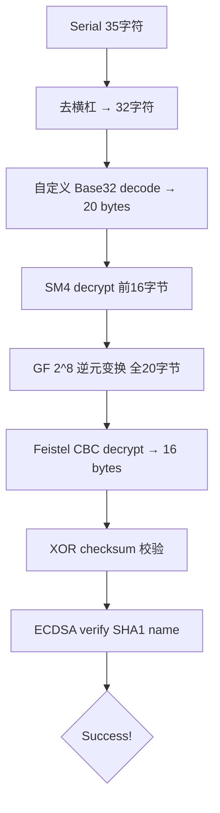

# KCTF 靶场 Windows 逆向（四）：TencentPediyKeygenMe — 六层密码学链的完全攻破

> 发布日期：2026-10-03
> 分析工具：Python（hashlib / pefile / struct）、Pollard Rho ECDLP 求解器
> 前篇：KCTF 靶场 Windows 逆向（一）～（三）

## 0. 本篇看点

**TencentPediyKeygenMe**（KCTF 靶场最高难度之一）——一道融合了六种密码学原语的 CrackMe，是整个 KCTF 系列中技术含量最高的一题。

验证链路（从 serial 到判定）：

```
serial(35字符) → 去掉3个横杠 → 32字符 Base32 decode → 20 bytes
→ SM4 decrypt [0:16] → GF(2^8) inverse → Feistel CBC decrypt
→ XOR checksum 校验 → ECDSA verify(SHA1(name), signature) → Success!
```

Keygen 的核心突破口：**64 位椭圆曲线**的阶只有 64 bit，可被 Pollard Rho 算法在约 2^32 步内攻破。私钥竟是 ASCII 字符串 `"Tencent "` (含尾部空格)！

---

## 1. 目标概况

| 属性 | 值 |
|------|---|
| 文件名 | TencentPediyKeygenMe2.exe |
| 格式 | Win32 PE, VC++ |
| 来源 | KCTF 靶场 Reverse 分类 |
| 输入 | 用户名 (Name) + 序列号 (Serial, 格式 XXXXXXXX-XXXXXXXX-XXXXXXXX-XXXXXXXX) |
| 目标 | 编写通用 Keygen |

---

## 2. 验证流程分析

逆向自 `0x408270` 的验证函数，完整流程如下：

### 2.1 序列号解码

```
输入: "A1B2C3D4-E5F6G7H8-J9K1M2N3-P4Q5R6S7" (35字符)
  ↓ 去掉3个横杠
"A1B2C3D4E5F6G7H8J9K1M2N3P4Q5R6S7" (32字符)
  ↓ 自定义 Base32 decode
20 bytes (raw_data)
```

**自定义 Base32 字母表**（32 字符，无 I/L/O/U）：

```
ABCDEFGHJKMNPQRSTVWXYZ1234567890
```

### 2.2 SM4 解密

```python
sm4_dec = sm4_decrypt_block(raw_data[0:16], key=b'Security@Tencent')
```

SM4 是中国国密算法（GB/T 32907-2016），但此处为自定义变种：
- 小端字节序（LE）
- 省略了标准 SM4 的 CK 常量检查

### 2.3 GF(2^8) 逆元变换

```python
gf_data = bytes(GF_INV[b] for b in sm4_dec)     # 前 16 字节
gf_tail = bytes(GF_INV[b] for b in raw_data[16:20])  # 尾部 4 字节
```

GF(2^8) 逆元在不可约多项式 `x^8 + x^4 + x^3 + x + 1`（`0x11b`）下计算：
- 性质：`GF_INV[GF_INV[x]] == x`（自逆）
- `GF_INV[0] = 0`

### 2.4 Feistel CBC 解密

```python
iv = gf_tail + b'\x00' * 4  # 8 字节 IV
sig = cbc_decrypt(key=b'DEADBEEF', iv=iv, data=gf_data)
```

自定义 Feistel 网络 + CBC 模式，8 字节块大小。

### 2.5 XOR 校验和

```python
dwords = struct.unpack('>4I', sig)  # 将 16 字节签名拆成 4 个 DWORD
chk = dwords[0] ^ dwords[1] ^ dwords[2] ^ dwords[3]
assert struct.pack('>I', chk) == gf_tail  # 校验和必须等于 GF 变换后的尾部
```

### 2.6 ECDSA 验证

```python
r = int.from_bytes(sig[0:8], 'big')
s = int.from_bytes(sig[8:16], 'big')
h = SHA1(name.encode())[:8]  # 截取前 8 字节
assert ecdsa_verify(h, r, s)  # 标准 ECDSA 验证
```

---

## 3. 椭圆曲线参数

```python
EC_P  = 0xc564eef070e69193   # 64 位素数域
EC_A  = EC_P - 3              # 曲线参数 a
EC_B  = 0x22996b9c33aeefdb   # 曲线参数 b
EC_N  = 0xc564eef19a080b07   # 群的阶
EC_GX = 0x2223a1d595845fa2   # 基点 G 的 x 坐标
EC_GY = 0x1c4eee9222ddda62   # 基点 G 的 y 坐标
EC_QX = 0x297a4a1e5b1fc99b   # 公钥 Q 的 x 坐标
EC_QY = 0x880198e3724f9fee   # 公钥 Q 的 y 坐标
```

关键观察：**阶 N 只有 64 位**，远小于密码学安全要求的 256 位。

---

## 4. Pollard Rho 破解 ECDLP

64 位椭圆曲线的离散对数问题可被 Pollard Rho 算法在 O(√N) ≈ 2^32 步内攻破。

```python
# 简化版 Pollard Rho
def pollard_rho(G, Q, N):
    # 三分法: 根据点的 x 坐标 mod 3 选择更新规则
    while True:
        a, b = random(), random()
        X = a*G + b*Q  # 初始点
        # ... Floyd 循环检测 ...
        # 找到 a1*G + b1*Q == a2*G + b2*Q
        # => d = (a1-a2) * (b2-b1)^{-1} mod N
        return d
```

运行约 9 分钟后得到结果：

```
私钥 d = 0x54656e63656e7420
```

转为 ASCII：**`"Tencent "`**（含尾部空格）！

验证：`d * G == Q` ✓

---

## 5. Keygen 实现

有了私钥 d，反向走完整个加密链即可生成 serial：

```python
def generate_serial(name, d):
    # 1. ECDSA 签名
    h = compute_hash(name)
    r, s = ecdsa_sign(h, d)
    sig = r.to_bytes(8, 'big') + s.to_bytes(8, 'big')
    
    # 2. XOR 校验和
    dwords = struct.unpack('>4I', sig)
    chk = dwords[0] ^ dwords[1] ^ dwords[2] ^ dwords[3]
    chk_bytes = struct.pack('>I', chk)
    
    # 3. Feistel CBC 加密
    iv = chk_bytes + b'\x00' * 4
    cipher_out = cbc_encrypt(b'DEADBEEF', iv, sig)
    
    # 4. GF(2^8) 逆元
    gf_out = bytes(GF_INV[b] for b in cipher_out)
    
    # 5. SM4 加密
    sm4_out = sm4_encrypt_block(gf_out, b'Security@Tencent')
    
    # 6. 组装 + GF 尾部
    raw_tail = bytes(GF_INV[b] for b in chk_bytes)
    raw20 = sm4_out + raw_tail
    
    # 7. Base32 编码 + 格式化
    b32 = base32_encode(raw20)
    return f'{b32[:8]}-{b32[8:16]}-{b32[16:24]}-{b32[24:]}'
```

### 示例输出

```
用户名: kanxue
序列号: XXXXXXXX-XXXXXXXX-XXXXXXXX-XXXXXXXX  (每次不同，因 ECDSA 使用随机 k)
自验证: 通过 ✓
```

---

## 6. 技术亮点

### 6.1 六层密码学链



### 6.2 各密码原语的作用

| 层 | 算法 | 作用 |
|---|------|------|
| 1 | Base32 | 编码/可读性 |
| 2 | SM4 | 对称加密混淆 |
| 3 | GF(2^8) | 非线性字节置换 |
| 4 | Feistel CBC | 块密码扩散 |
| 5 | XOR checksum | 完整性校验 |
| 6 | ECDSA | 数字签名认证 |

### 6.3 设计弱点

唯一致命弱点：**椭圆曲线阶仅 64 位**。现代密码学建议至少 256 位（如 secp256r1）。64 位曲线在现代硬件上可在分钟级别内被 Pollard Rho 攻破。

---

## 7. 文件清单

```
08_TencentPediyKeygenMe/
├── keygen.py            # 完整 Keygen（需 ecdlp_result.txt）
├── sm4_impl.py          # SM4 加密/解密实现
├── keygen_cipher.py     # Feistel CBC 加密/解密
├── ecdlp_v2.py          # Pollard Rho ECDLP 求解器
├── ecdlp_v2_result.txt  # 求解结果：d = 0x54656e63656e7420
└── TencentPediyKeygenMe2.exe  # 原始程序
```
