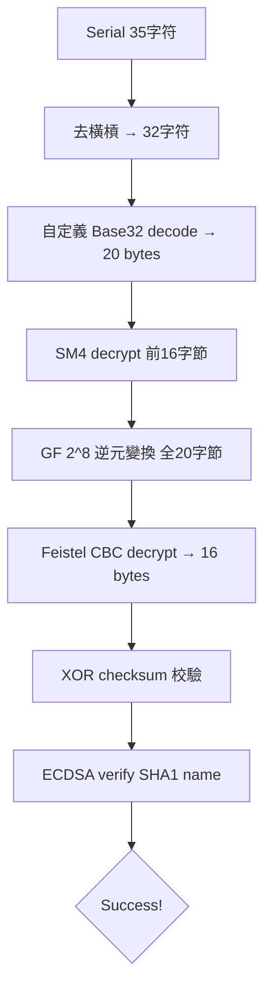

# KCTF 靶場 Windows 逆向（四）：TencentPediyKeygenMe — 六層密碼學鏈的完全攻破

> 發佈日期：2026-10-03
> 分析工具：Python（hashlib / pefile / struct）、Pollard Rho ECDLP 求解器
> 前篇：KCTF 靶場 Windows 逆向（一）～（三）

## 0. 本篇看點

**TencentPediyKeygenMe**（KCTF 靶場最高難度之一）——一道融合了六種密碼學原語的 CrackMe，是整個 KCTF 系列中技術含量最高的一題。

驗證鏈路（從 serial 到判定）：

```
serial(35字符) → 去掉3個橫槓 → 32字符 Base32 decode → 20 bytes
→ SM4 decrypt [0:16] → GF(2^8) inverse → Feistel CBC decrypt
→ XOR checksum 校驗 → ECDSA verify(SHA1(name), signature) → Success!
```

Keygen 的核心突破口：**64 位橢圓曲線**的階只有 64 bit，可被 Pollard Rho 算法在約 2^32 步內攻破。私鑰竟是 ASCII 字符串 `"Tencent "` (含尾部空格)！

---

## 1. 目標概況

| 屬性 | 值 |
|------|---|
| 文件名 | TencentPediyKeygenMe2.exe |
| 格式 | Win32 PE, VC++ |
| 來源 | KCTF 靶場 Reverse 分類 |
| 輸入 | 用戶名 (Name) + 序列號 (Serial, 格式 XXXXXXXX-XXXXXXXX-XXXXXXXX-XXXXXXXX) |
| 目標 | 編寫通用 Keygen |

---

## 2. 驗證流程分析

逆向自 `0x408270` 的驗證函數，完整流程如下：

### 2.1 序列號解碼

```
輸入: "A1B2C3D4-E5F6G7H8-J9K1M2N3-P4Q5R6S7" (35字符)
  ↓ 去掉3個橫槓
"A1B2C3D4E5F6G7H8J9K1M2N3P4Q5R6S7" (32字符)
  ↓ 自定義 Base32 decode
20 bytes (raw_data)
```

**自定義 Base32 字母表**（32 字符，無 I/L/O/U）：

```
ABCDEFGHJKMNPQRSTVWXYZ1234567890
```

### 2.2 SM4 解密

```python
sm4_dec = sm4_decrypt_block(raw_data[0:16], key=b'Security@Tencent')
```

SM4 是中國國密算法（GB/T 32907-2016），但此處爲自定義變種：
- 小端字節序（LE）
- 省略了標準 SM4 的 CK 常量檢查

### 2.3 GF(2^8) 逆元變換

```python
gf_data = bytes(GF_INV[b] for b in sm4_dec)     # 前 16 字節
gf_tail = bytes(GF_INV[b] for b in raw_data[16:20])  # 尾部 4 字節
```

GF(2^8) 逆元在不可約多項式 `x^8 + x^4 + x^3 + x + 1`（`0x11b`）下計算：
- 性質：`GF_INV[GF_INV[x]] == x`（自逆）
- `GF_INV[0] = 0`

### 2.4 Feistel CBC 解密

```python
iv = gf_tail + b'\x00' * 4  # 8 字節 IV
sig = cbc_decrypt(key=b'DEADBEEF', iv=iv, data=gf_data)
```

自定義 Feistel 網絡 + CBC 模式，8 字節塊大小。

### 2.5 XOR 校驗和

```python
dwords = struct.unpack('>4I', sig)  # 將 16 字節簽名拆成 4 個 DWORD
chk = dwords[0] ^ dwords[1] ^ dwords[2] ^ dwords[3]
assert struct.pack('>I', chk) == gf_tail  # 校驗和必須等於 GF 變換後的尾部
```

### 2.6 ECDSA 驗證

```python
r = int.from_bytes(sig[0:8], 'big')
s = int.from_bytes(sig[8:16], 'big')
h = SHA1(name.encode())[:8]  # 截取前 8 字節
assert ecdsa_verify(h, r, s)  # 標準 ECDSA 驗證
```

---

## 3. 橢圓曲線參數

```python
EC_P  = 0xc564eef070e69193   # 64 位素數域
EC_A  = EC_P - 3              # 曲線參數 a
EC_B  = 0x22996b9c33aeefdb   # 曲線參數 b
EC_N  = 0xc564eef19a080b07   # 羣的階
EC_GX = 0x2223a1d595845fa2   # 基點 G 的 x 座標
EC_GY = 0x1c4eee9222ddda62   # 基點 G 的 y 座標
EC_QX = 0x297a4a1e5b1fc99b   # 公鑰 Q 的 x 座標
EC_QY = 0x880198e3724f9fee   # 公鑰 Q 的 y 座標
```

關鍵觀察：**階 N 只有 64 位**，遠小於密碼學安全要求的 256 位。

---

## 4. Pollard Rho 破解 ECDLP

64 位橢圓曲線的離散對數問題可被 Pollard Rho 算法在 O(√N) ≈ 2^32 步內攻破。

```python
# 簡化版 Pollard Rho
def pollard_rho(G, Q, N):
    # 三分法: 根據點的 x 座標 mod 3 選擇更新規則
    while True:
        a, b = random(), random()
        X = a*G + b*Q  # 初始點
        # ... Floyd 循環檢測 ...
        # 找到 a1*G + b1*Q == a2*G + b2*Q
        # => d = (a1-a2) * (b2-b1)^{-1} mod N
        return d
```

運行約 9 分鐘後得到結果：

```
私鑰 d = 0x54656e63656e7420
```

轉爲 ASCII：**`"Tencent "`**（含尾部空格）！

驗證：`d * G == Q` ✓

---

## 5. Keygen 實現

有了私鑰 d，反向走完整個加密鏈即可生成 serial：

```python
def generate_serial(name, d):
    # 1. ECDSA 簽名
    h = compute_hash(name)
    r, s = ecdsa_sign(h, d)
    sig = r.to_bytes(8, 'big') + s.to_bytes(8, 'big')
    
    # 2. XOR 校驗和
    dwords = struct.unpack('>4I', sig)
    chk = dwords[0] ^ dwords[1] ^ dwords[2] ^ dwords[3]
    chk_bytes = struct.pack('>I', chk)
    
    # 3. Feistel CBC 加密
    iv = chk_bytes + b'\x00' * 4
    cipher_out = cbc_encrypt(b'DEADBEEF', iv, sig)
    
    # 4. GF(2^8) 逆元
    gf_out = bytes(GF_INV[b] for b in cipher_out)
    
    # 5. SM4 加密
    sm4_out = sm4_encrypt_block(gf_out, b'Security@Tencent')
    
    # 6. 組裝 + GF 尾部
    raw_tail = bytes(GF_INV[b] for b in chk_bytes)
    raw20 = sm4_out + raw_tail
    
    # 7. Base32 編碼 + 格式化
    b32 = base32_encode(raw20)
    return f'{b32[:8]}-{b32[8:16]}-{b32[16:24]}-{b32[24:]}'
```

### 示例輸出

```
用戶名: kanxue
序列號: XXXXXXXX-XXXXXXXX-XXXXXXXX-XXXXXXXX  (每次不同，因 ECDSA 使用隨機 k)
自驗證: 通過 ✓
```

---

## 6. 技術亮點

### 6.1 六層密碼學鏈



### 6.2 各密碼原語的作用

| 層 | 算法 | 作用 |
|---|------|------|
| 1 | Base32 | 編碼/可讀性 |
| 2 | SM4 | 對稱加密混淆 |
| 3 | GF(2^8) | 非線性字節置換 |
| 4 | Feistel CBC | 塊密碼擴散 |
| 5 | XOR checksum | 完整性校驗 |
| 6 | ECDSA | 數字簽名認證 |

### 6.3 設計弱點

唯一致命弱點：**橢圓曲線階僅 64 位**。現代密碼學建議至少 256 位（如 secp256r1）。64 位曲線在現代硬件上可在分鐘級別內被 Pollard Rho 攻破。

---

## 7. 文件清單

```
08_TencentPediyKeygenMe/
├── keygen.py            # 完整 Keygen（需 ecdlp_result.txt）
├── sm4_impl.py          # SM4 加密/解密實現
├── keygen_cipher.py     # Feistel CBC 加密/解密
├── ecdlp_v2.py          # Pollard Rho ECDLP 求解器
├── ecdlp_v2_result.txt  # 求解結果：d = 0x54656e63656e7420
└── TencentPediyKeygenMe2.exe  # 原始程序
```
